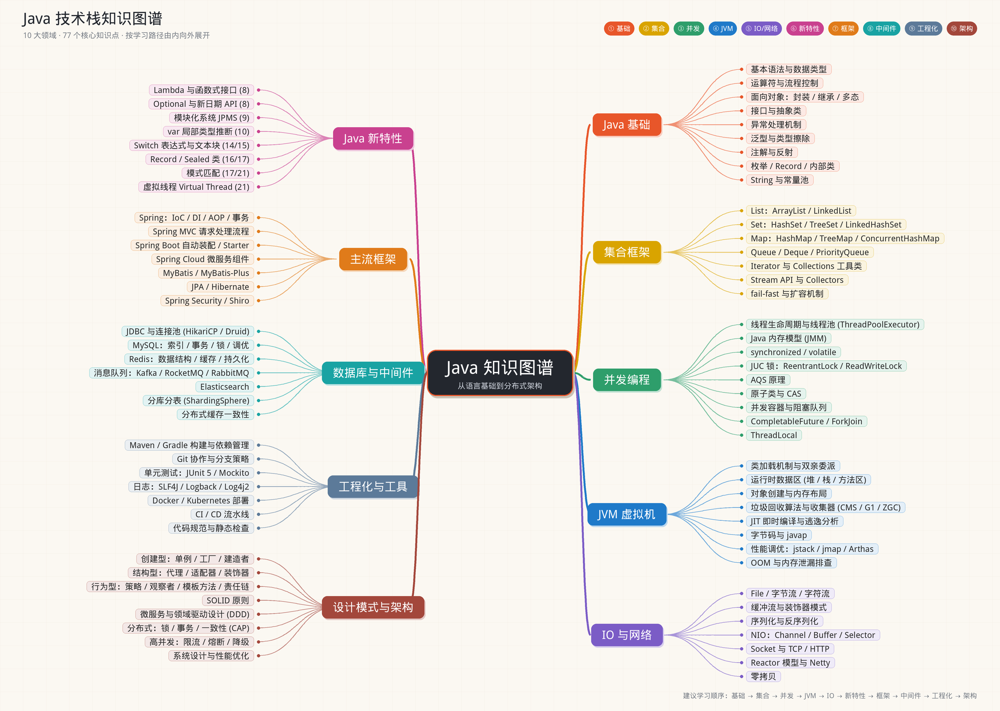

# Java 知识图谱学习工程

按 [Java 知识图谱](../docs/assets/java_knowledge_map.png) 的 **10 大领域 / 77 个知识点** 组织的学习资料与可运行示例。
每个知识点对应：一篇带图解的学习文档 + 一个可独立运行的示例类（打印讲解与实测结果）+ 参考的开源项目。



## 工程特点

- **零外部服务**：MySQL 相关用 H2 内存库真实执行 SQL；Spring / MyBatis / Redis / Kafka / ES / 注册中心 / 熔断器等全部用几十到两百行 Java **手写迷你实现**，看懂原理再去读真实源码。
- **示例即讲义**：每个 `*Demo` 都有 `main` 方法，运行后输出"现象 + 解释 + 面试要点 + 参考项目"。
- **难点配图**：文档中用 Mermaid 画流程图、时序图、状态机、类图（GitHub / IDEA / VS Code 可直接渲染）。
- **工程化样例可直接复用**：`Dockerfile`、`deploy/k8s.yaml`、`ci/github-actions.yml`、`ci/Jenkinsfile`、`config/checkstyle-sample.xml`、`docs/samples/logback-spring.xml`、`.editorconfig`。
- **真实的单元测试**：`src/test/java` 下有 JUnit 5 + Mockito 测试（`mvn test`）。

## 环境要求

- JDK **21**（示例用到 record、sealed、模式匹配、虚拟线程、文本块）
- Maven 3.8+（或使用 IDE 内置 Maven）

## 快速开始

```bash
cd java-learning

# 编译 + 运行单元测试
mvn -q test

# 列出全部 77 个示例
mvn -q exec:java

# 按类名运行一个示例
mvn -q exec:java -Dexec.args="OopDemo"

# 运行某一章全部示例（例如第 3 章并发）
mvn -q exec:java -Dexec.args="03"

# 直接指定主类
mvn -q exec:java -Ddemo=com.javalearning.concurrency.AqsDemo
```

在 IDE 中直接打开任意 `*Demo.java` 点运行即可。

## 内容索引

| 章节 | 文档 | 示例包 | 知识点 |
|------|------|--------|--------|
| 01 Java 基础 | [docs/01-java-basics.md](docs/01-java-basics.md) | `basics` | 语法与类型、运算符与流程、面向对象、接口与抽象类、异常、泛型、注解与反射、枚举/record/内部类、字符串与常量池 |
| 02 集合框架 | [docs/02-collections.md](docs/02-collections.md) | `collections` | List、Set、Map（HashMap 原理、LRU）、Queue、迭代器与工具类、Stream、fail-fast 与扩容 |
| 03 并发编程 | [docs/03-concurrency.md](docs/03-concurrency.md) | `concurrency` | 线程池、JMM、synchronized/volatile、Lock、AQS、CAS/原子类、并发集合、CompletableFuture/ForkJoin、ThreadLocal |
| 04 JVM | [docs/04-jvm.md](docs/04-jvm.md) | `jvm` | 类加载与双亲委派、运行时数据区、对象布局、GC 算法与收集器、JIT、字节码、调优工具、OOM 排查 |
| 05 IO 与网络 | [docs/05-io-network.md](docs/05-io-network.md) | `io` | 字节/字符流、装饰器流、序列化、NIO Selector、Socket/HTTP、Reactor 与 Netty 模型、零拷贝 |
| 06 Java 新特性 | [docs/06-modern-java.md](docs/06-modern-java.md) | `modern` | Lambda/函数式、Optional/时间 API、模块系统、var、switch 表达式/文本块、record/sealed、模式匹配、虚拟线程 |
| 07 主流框架 | [docs/07-frameworks.md](docs/07-frameworks.md) | `frameworks` | 手写 IoC/AOP/事务、DispatcherServlet、自动装配、注册中心/负载均衡/熔断/网关、MyBatis、JPA 概念、Security 过滤器链 |
| 08 数据库与中间件 | [docs/08-database-middleware.md](docs/08-database-middleware.md) | `middleware` | JDBC 与连接池、MySQL 索引/事务/锁、Redis、消息队列、Elasticsearch、分库分表、缓存一致性 |
| 09 工程化与工具 | [docs/09-engineering.md](docs/09-engineering.md) | `engineering` | Maven/Gradle、Git 与分支策略、JUnit 5/Mockito、日志、Docker/K8s、CI/CD、代码规范与静态检查 |
| 10 设计模式与架构 | [docs/10-patterns-architecture.md](docs/10-patterns-architecture.md) | `patterns` | 创建型/结构型/行为型模式、SOLID、DDD 与微服务、分布式锁/事务/CAP、限流熔断降级、系统设计与性能优化 |

## 目录结构

```
java-learning/
├── pom.xml                      # Java 21, H2, SLF4J, JUnit 5, Mockito, exec-maven-plugin
├── README.md
├── Dockerfile                   # 多阶段构建样例
├── .editorconfig
├── ci/                          # GitHub Actions / Jenkinsfile 样例
├── config/checkstyle-sample.xml
├── deploy/k8s.yaml              # Deployment / Service / Ingress / HPA 样例
├── docs/                        # 10 篇学习文档 + samples/logback-spring.xml
└── src/
    ├── main/java/com/javalearning/
    │   ├── Main.java            # 示例运行器
    │   ├── basics/ collections/ concurrency/ jvm/ io/ modern/
    │   └── frameworks/ middleware/ engineering/ patterns/
    ├── main/resources/simplelogger.properties
    └── test/java/com/javalearning/engineering/OrderServiceTest.java
```

## 建议的学习路径

1. **打基础**（01 → 02 → 03）：边看文档边运行示例，重点是集合源码级理解与并发模型。
2. **理解运行时**（04 → 05 → 06）：JVM 内存与 GC、IO 模型、新语法——这些决定你能否读懂框架源码。
3. **框架与中间件**（07 → 08）：先跑迷你实现，再对照 Spring / MyBatis / Redis 等真实源码。
4. **工程与架构**（09 → 10）：把配置样例用到自己的项目里；设计模式与分布式用示例里的"故障复现"建立直觉。

每篇文档末尾都有参考项目，推荐重点阅读：[Snailclimb/JavaGuide](https://github.com/Snailclimb/JavaGuide)、[CyC2018/CS-Notes](https://github.com/CyC2018/CS-Notes)、[doocs/advanced-java](https://github.com/doocs/advanced-java)、[iluwatar/java-design-patterns](https://github.com/iluwatar/java-design-patterns)、[spring-projects/spring-framework](https://github.com/spring-projects/spring-framework)、[netty/netty](https://github.com/netty/netty)、[alibaba/arthas](https://github.com/alibaba/arthas)。

## 运行注意事项

- `FailFastAndResizeDemo` 反射读取 `ArrayList` 内部数组需要 `--add-opens java.base/java.util=ALL-UNNAMED`（在 `MAVEN_OPTS` 或 IDE VM 参数中加），否则自动降级为按源码规则模拟。
- `TuningToolsDemo` 末尾会停留 10 秒并制造一个死锁，供你用 `jps` / `jstack` / `jcmd` 观察。
- `OomDemo`、`GcDemo` 会分配较多内存，默认堆即可运行；如需观察 GC 日志可加 `-Xlog:gc`。
- `MiniMvcDemo`、`MiniMyBatisDemo` 依赖 `-parameters` 编译参数保留形参名（pom 已配置；IDE 单独编译请确认开启）。
