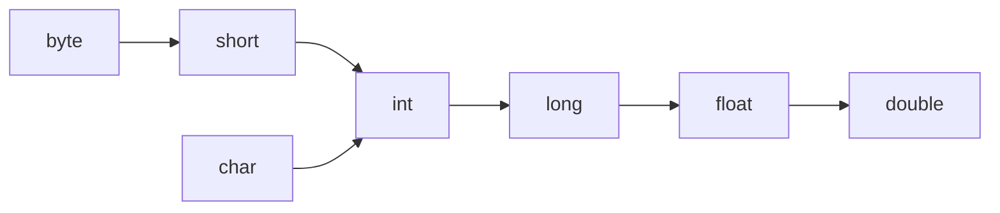
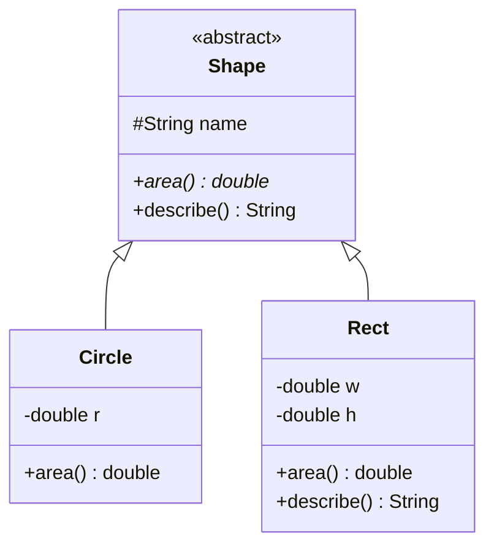
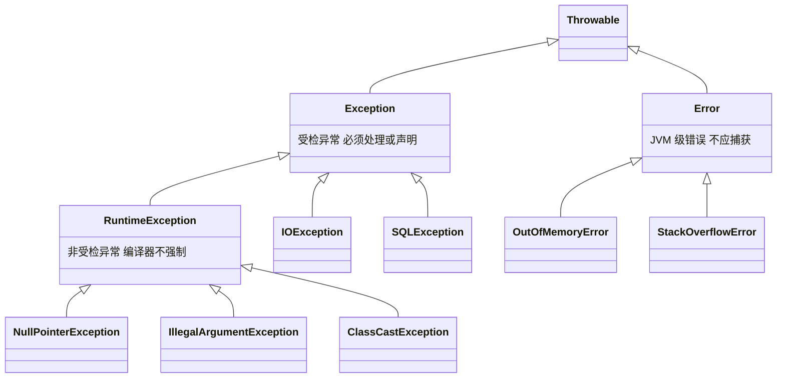
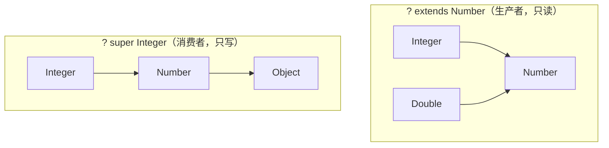
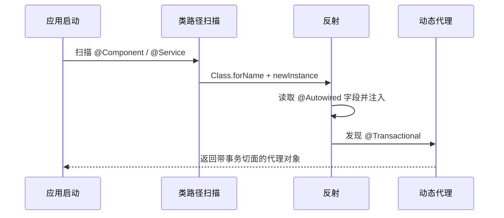
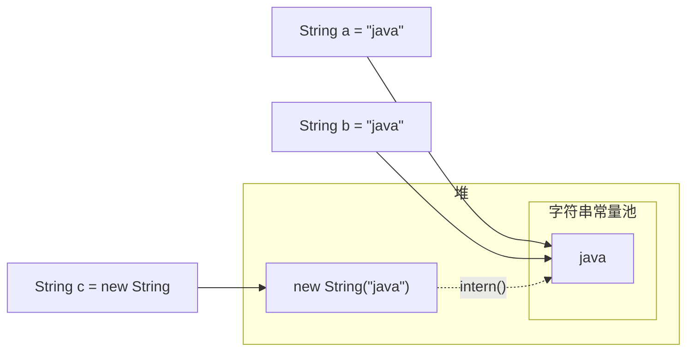

# 01 · Java 基础

> 语言核心，所有后续内容的地基。本章 9 个知识点，每个知识点对应 `src/main/java/com/javalearning/basics/` 下一个可运行示例。
>
> 运行方式：`mvn -q exec:java -Ddemo=com.javalearning.basics.OopDemo`

| # | 知识点 | 示例代码 | 难度 |
|---|--------|----------|------|
| 1-1 | 基本语法与数据类型 | `SyntaxAndTypesDemo` | ★ |
| 1-2 | 运算符与流程控制 | `OperatorsAndControlFlowDemo` | ★ |
| 1-3 | 面向对象：封装 / 继承 / 多态 | `OopDemo` | ★★ |
| 1-4 | 接口与抽象类 | `InterfaceVsAbstractDemo` | ★★ |
| 1-5 | 异常处理机制 | `ExceptionDemo` | ★★ |
| 1-6 | 泛型与类型擦除 | `GenericsDemo` | ★★★ |
| 1-7 | 注解与反射 | `AnnotationReflectionDemo` | ★★★ |
| 1-8 | 枚举 / Record / 内部类 | `EnumRecordInnerClassDemo` | ★★ |
| 1-9 | String 与常量池 | `StringPoolDemo` | ★★ |

---

## 1-1 基本语法与数据类型

**核心概念**

- 8 种基本类型：`byte(1) short(2) int(4) long(8) float(4) double(8) char(2) boolean`，其余全是引用类型。
- 包装类型用于泛型与集合；`Integer` 缓存 `-128 ~ 127`，超出范围 `==` 比较引用会得到 `false`。
- 整数溢出不报错而是回绕，需要时用 `Math.addExact`；浮点数不能精确表示十进制小数，金额用 `BigDecimal(String)`。

**类型提升规则**

- 二元运算时，低于 `int` 的类型先提升为 `int`；只要有一侧是更宽的类型，另一侧自动提升。
- 复合赋值 `+=` 隐含强转，所以 `byte b = 1; b += 1;` 可以编译，而 `b = b + 1;` 不行。

**常见面试题**

1. `Integer a = 127, b = 127; a == b` 为什么是 `true`，而 128 是 `false`？→ `IntegerCache`。
2. `0.1 + 0.2 == 0.3` 为什么是 `false`？→ IEEE 754 二进制浮点。
3. `short s = 1; s = s + 1;` 为什么编译失败？→ 结果为 `int` 需显式强转。

**参考项目**：[Snailclimb/JavaGuide](https://github.com/Snailclimb/JavaGuide) → Java 基础 · 基础语法；[CyC2018/CS-Notes](https://github.com/CyC2018/CS-Notes) → Java 基础。

---

## 1-2 运算符与流程控制

**核心概念**

- `&&` / `||` 短路，`&` / `|` 不短路（两侧都求值，可用于位运算）。
- 位运算在工程中的典型用途：权限位、`HashMap` 用 `(n-1) & hash` 代替取模、`>>>` 无符号右移用于 `(low + high) >>> 1` 防溢出求中点。
- 传统 `switch` 缺少 `break` 会穿透；Java 14+ 箭头形式 `case 1 ->` 不穿透并可作为表达式返回值。
- 标签 `outer:` 可以跳出多层循环，比设置 flag 变量更清晰。

**运算符优先级速记**（从高到低）：一元 `! ~ ++ --` → 算术 `* / %` → `+ -` → 位移 → 比较 → 相等 → `& ^ |` → `&& ||` → 三目 → 赋值。记不清就加括号。

---

## 1-3 面向对象：封装 / 继承 / 多态

**核心概念**

- **封装**：字段私有、行为公开。对象对外暴露的是"能做什么"，不是"有什么数据"。
- **继承**：子类复用父类实现，构造时先执行父类构造器（构造链）。Java 是单继承。
- **多态**：同一引用调用同一方法，运行时根据实际对象类型决定执行哪一个（动态分派）。

**重写 vs 重载**

| 维度 | 重载 Overload | 重写 Override |
|------|---------------|---------------|
| 发生位置 | 同一个类 | 父子类之间 |
| 方法签名 | 方法名相同、参数不同 | 完全相同 |
| 决定时机 | 编译期（静态类型） | 运行期（实际类型） |
| 返回值 | 可以不同 | 相同或协变子类型 |

**哪些不参与多态**：`static` 方法（属于类）、字段（按静态类型解析，叫"隐藏"）、`private` 方法、构造器。

**参考项目**：[iluwatar/java-design-patterns](https://github.com/iluwatar/java-design-patterns) 中 Template Method 模式是"继承 + 多态"的经典应用。

---

## 1-4 接口与抽象类

**核心概念**

- 接口描述**能力**（can-do），抽象类描述**身份**（is-a）。
- Java 8 接口可有 `default` 和 `static` 方法；Java 9 可有 `private` 方法。接口字段隐式 `public static final`。
- 一个类实现两个接口且它们有同名 `default` 方法时，必须重写并用 `接口名.super.方法()` 显式选择。

**选型对照**

| 需求 | 接口 | 抽象类 |
|------|------|--------|
| 多实现 | ✅ | ❌（单继承） |
| 实例字段 / 构造器 | ❌ | ✅ |
| 非 public 成员 | 仅 private 方法 | ✅ |
| 典型例子 | `Comparable` `Runnable` `List` | `AbstractList` `InputStream` `HttpServlet` |

JDK 中最典型的组合：`List`（接口）← `AbstractList`（骨架抽象类）← `ArrayList`（实现）。

---

## 1-5 异常处理机制

**异常体系**

**最佳实践**

1. 优先使用 try-with-resources；资源按打开的**逆序**关闭，关闭时的异常作为 Suppressed 附加到主异常。
2. 不要在 `finally` 中 `return`——会吞掉 try 中的返回值和异常。
3. 底层异常要**转译**为业务异常并保留 `cause`（异常链），不要 `catch (Exception e) {}` 吞掉。
4. 业务异常通常继承 `RuntimeException` 并携带错误码，由全局处理器（如 Spring 的 `@ControllerAdvice`）统一转为响应。
5. 异常不要用于控制流程——创建异常需要填充栈帧，成本高。

**参考项目**：[spring-projects/spring-framework](https://github.com/spring-projects/spring-framework) 的 `DataAccessException` 体系是"受检异常转译为非受检异常层次"的典范。

---

## 1-6 泛型与类型擦除

**核心概念**

- 泛型提供**编译期**类型安全，运行时被擦除为上界（无上界则为 `Object`）。
- `List<String>` 和 `List<Integer>` 在运行时是同一个 `Class`。
- 编译器为保持多态会生成**桥方法**（bridge method）。

**PECS 原则**

- 只从集合**读取** → `<? extends T>`（如 `Collections.copy` 的 src）。
- 只向集合**写入** → `<? super T>`（如 `Comparator<? super T>`）。
- 又读又写 → 不要用通配符。

**擦除带来的限制**

- 不能 `new T()`、不能 `new T[]`、不能 `instanceof List<String>`、不能用基本类型做类型参数。
- 静态字段/方法不能引用类的类型参数。
- 解决方案：传入 `Class<T>` 令牌（`Jackson` 的 `TypeReference` 用匿名子类保留泛型签名）。

---

## 1-7 注解与反射

**核心概念**

- 注解本质是接口（`@interface`），元注解 `@Retention(RUNTIME)` 决定能否在运行时被反射读取，`@Target` 限制使用位置。
- 反射三件套：`Class` → `Field / Method / Constructor`，`setAccessible(true)` 可访问私有成员。
- JDK 动态代理（`Proxy.newProxyInstance`）要求目标实现接口；CGLIB / ByteBuddy 通过生成子类代理普通类。

**框架是如何用它们的**

示例 `AnnotationReflectionDemo` 用 30 行实现了一个参数校验器与一个计时切面，对应 Hibernate Validator 与 Spring AOP 的最简模型。

**性能提示**：反射调用比直接调用慢一个数量级，框架会缓存 `Method` 对象并在热点路径用 `MethodHandle` 或字节码生成替代。

**参考项目**：[spring-projects/spring-framework](https://github.com/spring-projects/spring-framework)（`ReflectionUtils`、`AnnotationUtils`）、[raphw/byte-buddy](https://github.com/raphw/byte-buddy)。

---

## 1-8 枚举 / Record / 内部类

**枚举**

- 枚举常量是 `public static final` 单例，`==` 可直接比较，`values()` / `valueOf()` 由编译器生成。
- 可实现接口、每个常量可有独立方法体——策略模式的最简形式。
- `EnumMap` / `EnumSet` 基于 ordinal 数组与位向量，比 `HashMap` / `HashSet` 更快。
- 单例模式的最佳实现是 `enum Singleton { INSTANCE }`（天然防反射、防序列化破坏）。

**Record（Java 16）**

- 不可变数据载体，自动生成 `构造器 / 访问器 / equals / hashCode / toString`。
- 紧凑构造器 `Point { ... }` 用于参数校验；不能声明实例字段，可以声明静态成员与方法。
- 适合 DTO / 值对象 / Map 的复合 key。

**内部类**

| 类型 | 持有外部引用 | 典型用途 |
|------|--------------|----------|
| 成员内部类 | ✅ `Outer.this` | 需要访问外部实例状态（如迭代器 `ArrayList.Itr`） |
| 静态内部类 | ❌ | 默认首选（`HashMap.Node`、Builder） |
| 局部类 | 看是否在实例方法中 | 方法内临时类型 |
| 匿名类 | 同上 | 一次性实现，Java 8 后多被 Lambda 取代 |

> 非静态内部类持有外部引用是 Android / 长生命周期对象中内存泄漏的常见来源。

---

## 1-9 String 与常量池

**内存模型**

**要点**

- 字面量直接进常量池；`new String("x")` 在堆上额外创建一个对象；`intern()` 返回池中引用（JDK 7+ 池在堆中）。
- 编译期常量（字面量、`final` 常量）拼接会被折叠进池；含变量的拼接在运行期产生新对象。
- `String` 不可变：底层 `final byte[]`，没有修改方法。好处是线程安全、`hashCode` 可缓存、适合作 key、支持池共享。
- 循环中拼接请用 `StringBuilder`；单条语句的 `+` 编译器已优化。
- Java 9 紧凑字符串：纯 Latin-1 每字符 1 字节，否则 UTF-16 2 字节。`length()` 返回 UTF-16 单元数，表情符号会占 2 个单元。

**参考项目**：阅读 OpenJDK [`java.lang.String`](https://github.com/openjdk/jdk/blob/master/src/java.base/share/classes/java/lang/String.java) 源码中的 `coder` 与 `hash` 字段。
