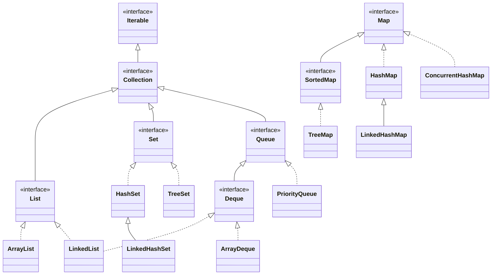
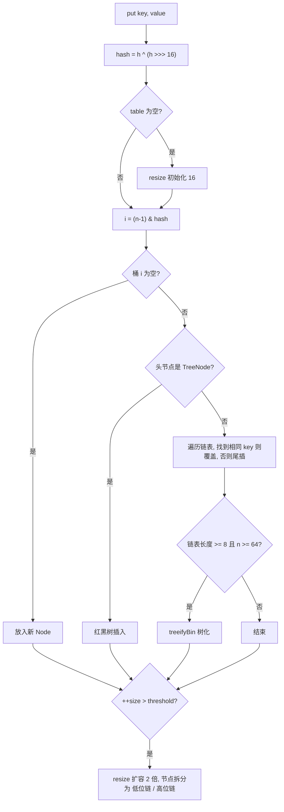
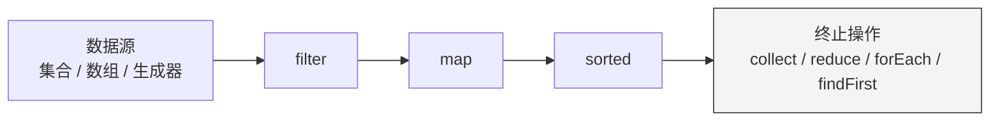

# 02 · 集合框架

> 日常编码最高频的 API，也是面试必考区。示例位于 `src/main/java/com/javalearning/collections/`。

| # | 知识点 | 示例代码 | 难度 |
|---|--------|----------|------|
| 2-1 | List：ArrayList / LinkedList | `ListDemo` | ★ |
| 2-2 | Set：HashSet / TreeSet / LinkedHashSet | `SetDemo` | ★★ |
| 2-3 | Map：HashMap / TreeMap / ConcurrentHashMap | `MapDemo` | ★★★ |
| 2-4 | Queue / Deque / PriorityQueue | `QueueDemo` | ★★ |
| 2-5 | Iterator 与 Collections 工具类 | `IteratorAndCollectionsDemo` | ★ |
| 2-6 | Stream API 与 Collectors | `StreamDemo` | ★★ |
| 2-7 | fail-fast 与扩容机制 | `FailFastAndResizeDemo` | ★★★ |

## 全景图

> `Map` 不继承 `Collection`，但 `HashSet` 内部就是一个 `HashMap`（value 为常量 `PRESENT`）。

## 选型速查

| 需求 | 首选 | 备注 |
|------|------|------|
| 有序可重复、随机访问 | `ArrayList` | 几乎总是对的选择 |
| 频繁头尾操作 / 栈 / 队列 | `ArrayDeque` | 比 `LinkedList`、`Stack` 都快 |
| 去重、无序 | `HashSet` | 元素需正确实现 `equals/hashCode` |
| 去重、保持插入顺序 | `LinkedHashSet` | |
| 去重、自动排序、范围查询 | `TreeSet` | 元素需 `Comparable` 或传 `Comparator` |
| 键值查找 | `HashMap` | 允许 1 个 null key |
| LRU 缓存 | `LinkedHashMap(accessOrder=true)` | 重写 `removeEldestEntry` |
| 按键排序、范围 / floor / ceiling | `TreeMap` | 红黑树 O(log n) |
| 高并发读写 | `ConcurrentHashMap` | 不允许 null |
| 读多写极少的并发列表 | `CopyOnWriteArrayList` | 写时复制 |
| 优先级调度 / Top-K | `PriorityQueue` | 二叉堆 |

---

## 2-1 List：ArrayList / LinkedList

- `ArrayList`：`Object[]` 动态数组，`get(i)` O(1)，尾插摊销 O(1)，中间插删 O(n)（`System.arraycopy`）。
- `LinkedList`：双向链表，头尾插删 O(1)，但 `get(i)` O(n)，节点对象开销大、缓存不友好。实际中几乎总是输给 `ArrayList`/`ArrayDeque`。
- `Arrays.asList` 返回数组视图（固定长度，可 set）；`List.of` 完全不可变且拒绝 null；`List.copyOf` 生成不可变快照。
- 遍历中删除用 `removeIf` 或 `Iterator.remove`。

---

## 2-2 Set：HashSet / TreeSet / LinkedHashSet

- `HashSet` 去重依赖 `hashCode()` 先定位桶、再用 `equals()` 比较；二者必须同时正确实现（相等对象的 hashCode 必须相等）。
- `TreeSet` 去重依赖 `compareTo()` / `Comparator` 返回 0，和 `equals` 无关——自定义比较器时要小心"误判重复"。
- 可变对象放入 `HashSet` 后修改参与 hash 的字段，会导致对象"丢失"（`contains` 为 false，`remove` 失败）。因此 key / 元素应当不可变，优先用 `record`。

---

## 2-3 Map：HashMap / TreeMap / ConcurrentHashMap

### HashMap 的 put 流程（JDK 8+）

**关键数字**：初始容量 16、负载因子 0.75、树化阈值 8（且表 ≥ 64）、退化阈值 6、扩容 2 倍。

**为什么容量必须是 2 的幂**：`(n-1) & hash` 等价于取模但更快；扩容时只需看 hash 新增的那一位，元素要么原地不动、要么移动到 `i + oldCap`，不需要重新计算。

**线程不安全的表现**：并发 `put` 丢数据、`size` 不准；JDK 7 头插法扩容在并发下会成环导致 `get` 死循环。

### ConcurrentHashMap（JDK 8+）

- 放弃 Segment 分段锁，改为 `Node[]` + CAS 插入空桶 + `synchronized` 锁桶头节点（粒度更细）。
- 读无锁（`volatile` 保证可见性）；`size()` 基于 `baseCount + CounterCell[]` 分片计数。
- 扩容支持多线程协作（`ForwardingNode` + `transferIndex`）。
- 不允许 null key/value（避免二义性）；`computeIfAbsent` 内部不要再写同一个 map。

### TreeMap

红黑树实现的 `NavigableMap`：`floorKey / ceilingKey / headMap / tailMap / subMap` 让"区间查找、找最近值"变得 O(log n)。典型应用：分段计费、一致性哈希环、版本区间匹配。

**参考项目**：阅读 OpenJDK [`HashMap.java`](https://github.com/openjdk/jdk/blob/master/src/java.base/share/classes/java/util/HashMap.java) 的 `putVal`、`resize`；[google/guava](https://github.com/google/guava) 的 `Maps.newHashMapWithExpectedSize`、`ImmutableMap`。

---

## 2-4 Queue / Deque / PriorityQueue

| 操作 | 抛异常 | 返回特殊值 | 阻塞（BlockingQueue） | 超时 |
|------|--------|-----------|------------------------|------|
| 入队 | `add` | `offer` | `put` | `offer(e, t, u)` |
| 出队 | `remove` | `poll` | `take` | `poll(t, u)` |
| 查看 | `element` | `peek` | - | - |

- `ArrayDeque`：循环数组实现，栈/队列的首选；不允许 null。
- `PriorityQueue`：数组表示的二叉堆，`offer/poll` O(log n)；遍历顺序不是排序顺序。Top-K 用"大小为 K 的小顶堆"。
- `java.util.Stack` 继承 `Vector`，方法全部 `synchronized`，已不推荐。

---

## 2-5 Iterator 与 Collections 工具类

- for-each 是 `Iterator` 的语法糖；实现 `Iterable<T>` 即可让自定义类型支持 for-each。
- `Collections`：`sort`（稳定 TimSort）、`binarySearch`、`reverse/shuffle/swap/rotate`、`max/min/frequency`、`unmodifiableXxx`（只读视图）、`synchronizedXxx`（粗粒度锁）、`emptyList/singletonList`。
- `Arrays.sort` 对基本类型用双轴快排（不稳定但快），对对象用 TimSort（稳定）。

---

## 2-6 Stream API 与 Collectors

- **惰性求值**：中间操作只是搭建管道，终止操作才触发执行；`findFirst / anyMatch / limit` 可以短路。
- **一次性**：流被消费后不能复用。
- **常用 Collectors**：`toList / toSet / toMap(k, v, merge)`、`groupingBy(classifier, downstream)`、`partitioningBy`、`joining`、`counting / summingX / averagingX`、`mapping`、`collectingAndThen`、`teeing`（Java 12）。
- **基本类型流**：`IntStream / LongStream / DoubleStream` 避免装箱；`mapToInt`、`boxed`、`summaryStatistics`。
- **并行流**：共用 `ForkJoinPool.commonPool`；只适合 CPU 密集 + 大数据量 + 易拆分的源。有副作用的 lambda 在并行下会出错。
- Java 16 `stream.toList()` 返回不可变列表。

**参考项目**：[amaembo/streamex](https://github.com/amaembo/streamex) 增强版 Stream；[vavr-io/vavr](https://github.com/vavr-io/vavr) 函数式集合。

---

## 2-7 fail-fast 与扩容机制

### fail-fast

- `ArrayList / HashMap` 等维护 `modCount`，迭代器创建时复制为 `expectedModCount`，`next()` 时两者不等即抛 `ConcurrentModificationException`。
- 它只是尽力检测，不是并发安全保证；删除倒数第二个元素时甚至不会抛异常（`hasNext()` 直接返回 false）。
- fail-safe 容器（`CopyOnWriteArrayList`、`ConcurrentHashMap`）在快照或弱一致视图上迭代，不抛异常但可能看不到最新数据。

### 扩容

| 容器 | 初始 | 触发 | 新容量 |
|------|------|------|--------|
| `ArrayList` | 首次 add 分配 10 | 满了 | 1.5 倍 |
| `HashMap` | 首次 put 分配 16 | size > cap × 0.75 | 2 倍 |
| `ArrayDeque` | 16（或 8） | 满了 | 2 倍（小于 64 时 +2） |
| `StringBuilder` | 16 | 不够 | 2 倍 + 2 |

预估容量（`new ArrayList<>(n)`、`new HashMap<>((int) (n / 0.75f) + 1)`）可以避免反复搬迁，大循环里差异明显。

> 示例通过反射读取真实容量；Java 16+ 需加 `--add-opens java.base/java.util=ALL-UNNAMED`，否则示例会自动改为按源码规则模拟。
