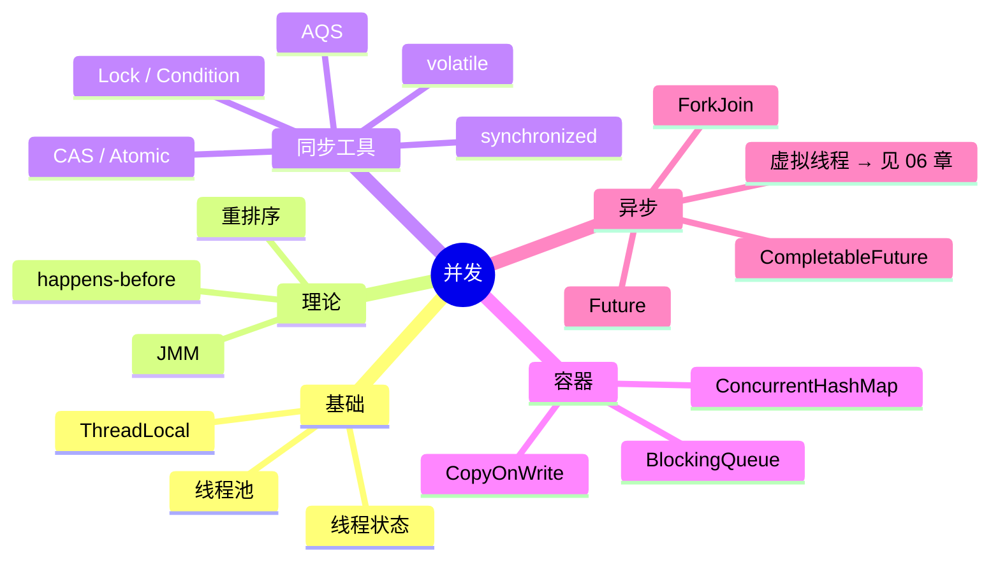
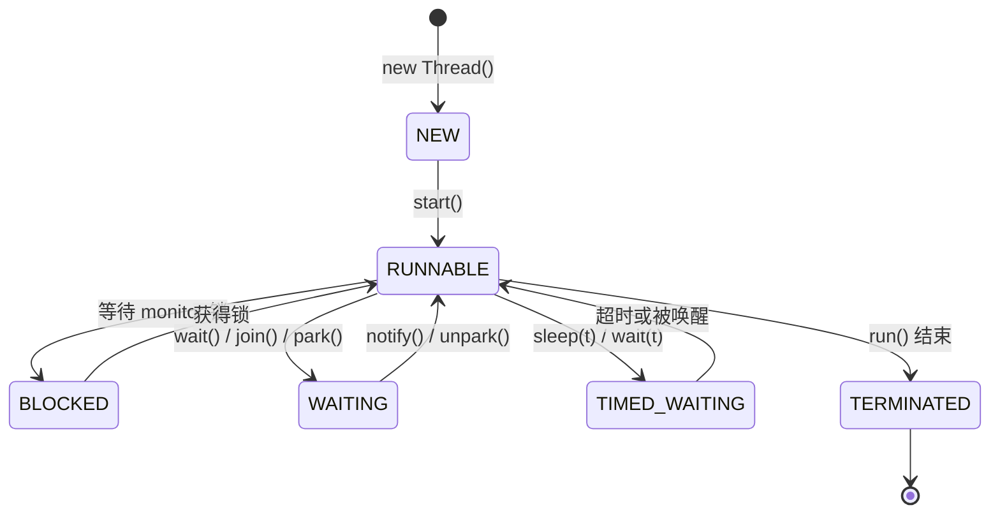
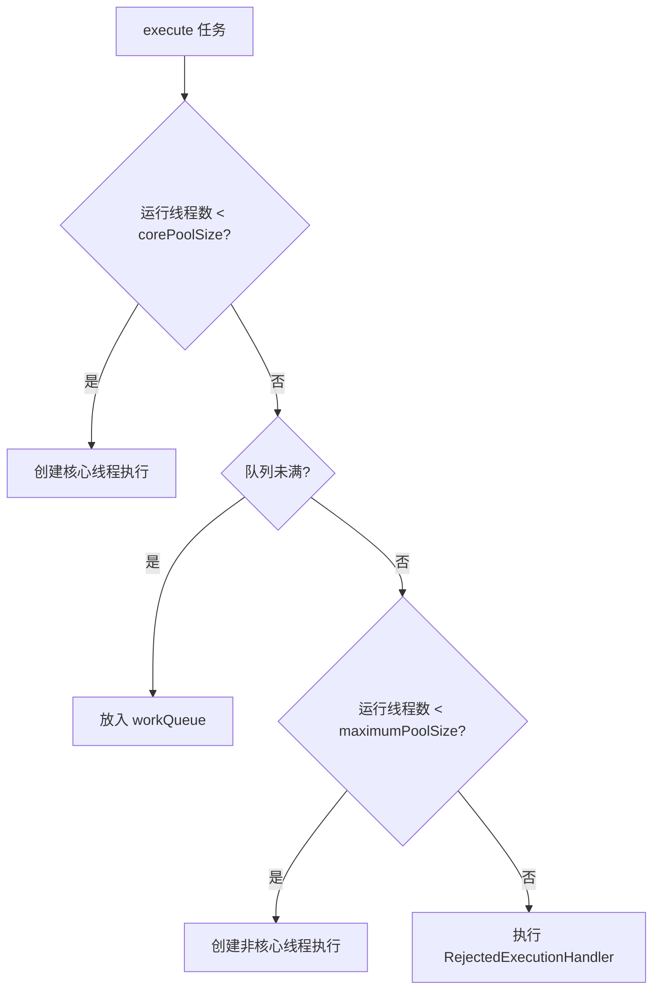
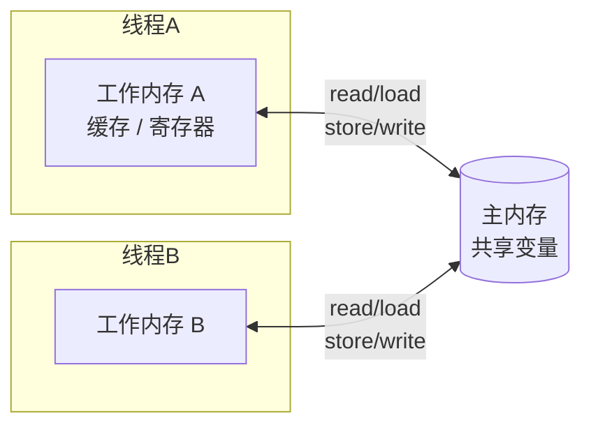
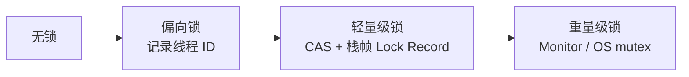
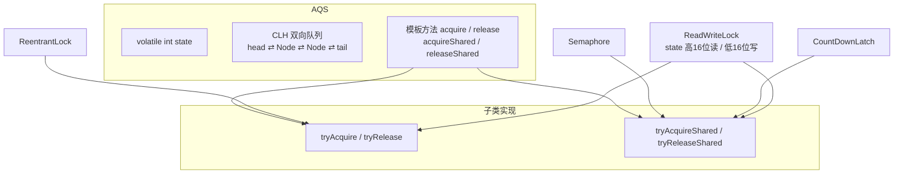
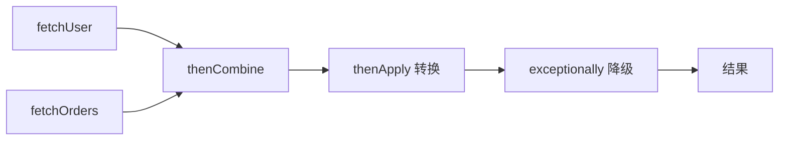
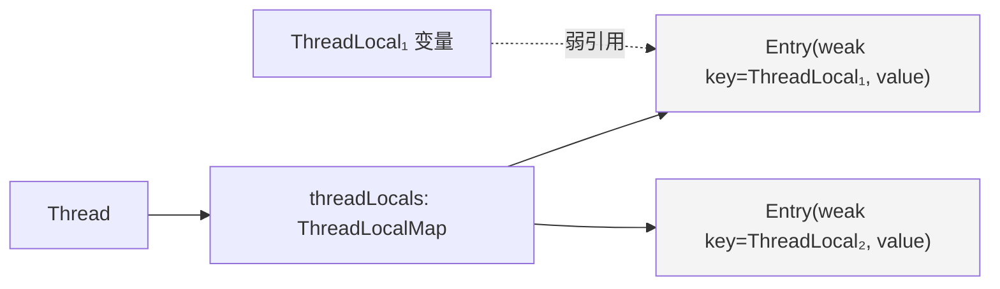

# 03 · 并发编程

> 进入中高级的分水岭。示例位于 `src/main/java/com/javalearning/concurrency/`。

| # | 知识点 | 示例代码 | 难度 |
|---|--------|----------|------|
| 3-1 | 线程生命周期与线程池 | `ThreadPoolDemo` | ★★ |
| 3-2 | Java 内存模型 (JMM) | `JmmDemo` | ★★★ |
| 3-3 | synchronized / volatile | `SynchronizedVolatileDemo` | ★★ |
| 3-4 | JUC 锁：ReentrantLock / ReadWriteLock | `LockDemo` | ★★★ |
| 3-5 | AQS 原理 | `AqsDemo` | ★★★★ |
| 3-6 | 原子类与 CAS | `AtomicCasDemo` | ★★★ |
| 3-7 | 并发容器与阻塞队列 | `ConcurrentCollectionsDemo` | ★★ |
| 3-8 | CompletableFuture / ForkJoin | `CompletableFutureDemo` | ★★★ |
| 3-9 | ThreadLocal | `ThreadLocalDemo` | ★★ |

## 知识地图



---

## 3-1 线程生命周期与线程池

### 线程状态



### ThreadPoolExecutor 的任务提交流程



**7 个构造参数**：`corePoolSize`、`maximumPoolSize`、`keepAliveTime`、`unit`、`workQueue`、`threadFactory`、`handler`。

**4 种拒绝策略**：`AbortPolicy`（默认，抛异常）、`CallerRunsPolicy`（调用者线程执行，起到背压作用）、`DiscardPolicy`、`DiscardOldestPolicy`。

**为什么不用 `Executors`**：`newFixedThreadPool` 用无界队列可能 OOM；`newCachedThreadPool` 线程数无上限。阿里规范要求手动 `new ThreadPoolExecutor`。

**参考项目**：[alibaba/transmittable-thread-local](https://github.com/alibaba/transmittable-thread-local)；[dynamic-tp 动态线程池](https://github.com/dromara/dynamic-tp)。

---

## 3-2 Java 内存模型（JMM）



- **原子性**：基本类型读写原子（`long/double` 在 32 位 JVM 上例外），`i++` 不是。
- **可见性**：一个线程的修改何时对其他线程可见。`volatile`、`synchronized`、`final` 都能保证。
- **有序性**：编译器和 CPU 会重排序，只保证单线程语义不变（as-if-serial）。多线程需 happens-before 约束。

**happens-before** 是 JMM 给程序员的承诺：如果 A hb B，则 A 的结果对 B 可见。八条规则见示例输出。

**volatile 的实现**：写后插入 StoreLoad 屏障（x86 用 `lock` 前缀指令），强制刷新到主内存并使其他核心缓存行失效（MESI 协议）。

---

## 3-3 synchronized / volatile

| | synchronized | volatile |
|---|---|---|
| 原子性 | ✅ | ❌（只保证单次读写） |
| 可见性 | ✅ | ✅ |
| 有序性 | ✅ | ✅ |
| 阻塞 | 会 | 不会 |
| 适用 | 复合操作、临界区 | 状态标志、DCL 单例、一写多读 |

### 锁升级（对象头 Mark Word）



- JDK 15 起偏向锁默认禁用（维护成本高、收益下降）。
- 自旋锁 / 自适应自旋减少线程挂起开销；锁消除（逃逸分析）、锁粗化是 JIT 的优化。
- `wait/notify` 必须在 `synchronized` 内调用；用 `while` 检查条件防止虚假唤醒；优先 `notifyAll`。

---

## 3-4 JUC 锁

| 能力 | synchronized | ReentrantLock |
|------|--------------|---------------|
| 可重入 | ✅ | ✅ |
| 尝试获取 / 超时 | ❌ | `tryLock()` / `tryLock(t, u)` |
| 可中断 | ❌ | `lockInterruptibly()` |
| 公平锁 | ❌ | `new ReentrantLock(true)` |
| 多条件队列 | 一个 | 多个 `Condition` |
| 释放 | 自动 | 必须在 `finally` 中 `unlock()` |

- **ReentrantReadWriteLock**：读读共享、读写 / 写写互斥；支持锁降级（写→读），不支持升级。写饥饿问题由 `StampedLock` 的乐观读缓解。
- **StampedLock**：三种模式（写、悲观读、乐观读），乐观读不加锁只校验版本戳，吞吐最高；不可重入、无 Condition。
- 标准写法：

```java
lock.lock();
try {
    // 临界区
} finally {
    lock.unlock();
}
```

---

## 3-5 AQS 原理



**acquire 流程**：`tryAcquire` 失败 → `addWaiter` 封装 Node 入队 → `acquireQueued` 自旋检查前驱是否为 head，是则再次 `tryAcquire`，否则 `LockSupport.park`。
**release 流程**：`tryRelease` 成功 → `unparkSuccessor` 唤醒 head 的后继。

示例 `AqsDemo` 用 AQS 分别实现了互斥锁与闭锁，各不到 40 行。

**参考项目**：阅读 OpenJDK [`AbstractQueuedSynchronizer.java`](https://github.com/openjdk/jdk/blob/master/src/java.base/share/classes/java/util/concurrent/locks/AbstractQueuedSynchronizer.java) 顶部 Doug Lea 的长注释。

---

## 3-6 原子类与 CAS

- **CAS(V, E, N)**：当内存值 V == 期望值 E 时才写入新值 N，整个过程是一条 CPU 指令（`lock cmpxchg`）。
- **三大问题**：
  1. **ABA**：值被改成 B 又改回 A，CAS 察觉不到 → `AtomicStampedReference` 加版本号。
  2. **自旋开销**：高竞争下 CPU 空转 → `LongAdder` 分段累加、或退回锁。
  3. **只能保证一个变量**：多个变量打包成对象用 `AtomicReference`。
- **LongAdder**：`base + Cell[]`，线程 hash 到不同 Cell 累加，`sum()` 时汇总。统计计数首选；需要精确 CAS 语义（如限流器的 `compareAndSet`）仍用 `AtomicLong`。
- Java 9 起 `VarHandle` 替代 `Unsafe` 作为公开的底层原子操作 API。

---

## 3-7 并发容器与阻塞队列

| 队列 | 有界 | 结构 | 典型用途 |
|------|------|------|----------|
| `ArrayBlockingQueue` | ✅ | 数组 + 一把锁 | 固定容量缓冲 |
| `LinkedBlockingQueue` | 可选（默认无界） | 链表 + 两把锁 | 线程池队列（请指定容量） |
| `SynchronousQueue` | 容量 0 | 直接交接 | `newCachedThreadPool` |
| `PriorityBlockingQueue` | ❌ | 堆 | 优先级任务 |
| `DelayQueue` | ❌ | 堆 + 到期才可取 | 延迟任务、超时关闭 |
| `LinkedTransferQueue` | ❌ | CAS 链表 | 高性能生产消费 |

- `ConcurrentHashMap` 的 `putIfAbsent / merge / compute*` 是原子的，用它们替代 "check-then-act"。
- `CopyOnWriteArrayList` 写时复制，适合监听器列表等读多写少的场景。
- `ConcurrentSkipListMap/Set`：并发有序结构，跳表比平衡树更易无锁化。

---

## 3-8 CompletableFuture / ForkJoin



| 方法 | 作用 |
|------|------|
| `supplyAsync / runAsync` | 发起异步任务（可指定线程池） |
| `thenApply / thenAccept / thenRun` | 同步转换（在完成线程执行） |
| `thenApplyAsync` | 切换到指定池 |
| `thenCompose` | 串行依赖，扁平化嵌套 Future |
| `thenCombine` | 两个独立 Future 合并 |
| `allOf / anyOf` | 聚合多个 Future |
| `exceptionally / handle / whenComplete` | 异常处理 |
| `orTimeout / completeOnTimeout` | 超时（Java 9） |

**注意**：默认使用 `ForkJoinPool.commonPool()`（并行度 = 核数 - 1），IO 阻塞任务务必传自定义线程池。

**ForkJoin**：分治 + 工作窃取（work-stealing），每个线程有自己的双端队列，空闲时从他人队尾偷任务。`parallelStream` 与 `CompletableFuture` 默认都跑在它上面。

---

## 3-9 ThreadLocal



- `ThreadLocalMap` 挂在 `Thread` 对象上，key 是 `ThreadLocal` 的**弱引用**，value 是**强引用**。
- 线程池中线程长期存活，不 `remove()` 会导致 value 泄漏和下一个任务读到脏数据。标准写法 `try { set } finally { remove }`。
- `InheritableThreadLocal` 在 `new Thread` 时拷贝父线程值；线程池复用场景失效，需要 [TransmittableThreadLocal](https://github.com/alibaba/transmittable-thread-local)。
- 典型应用：Spring 的 `RequestContextHolder`、`TransactionSynchronizationManager`、MDC 日志上下文、分布式 TraceId 传递。
