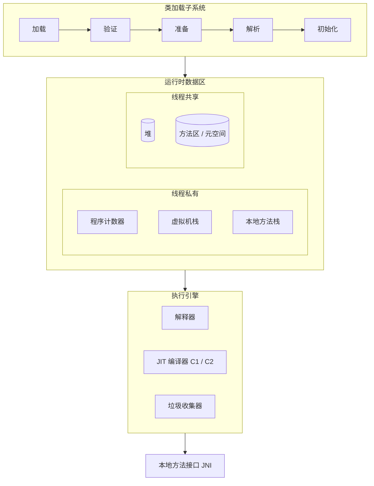
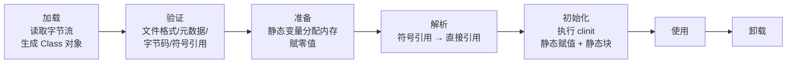
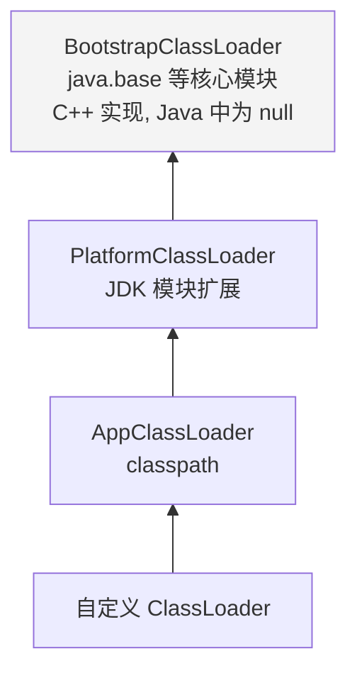
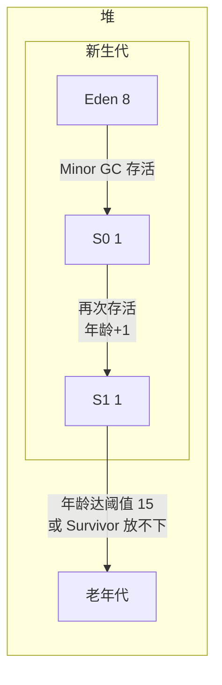
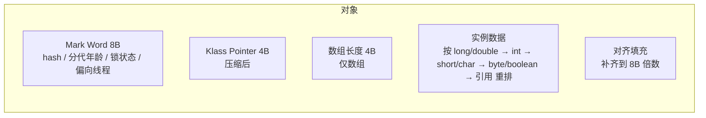
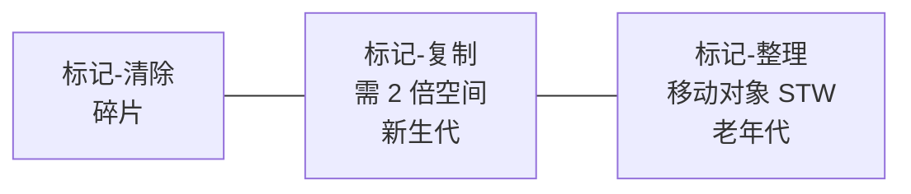
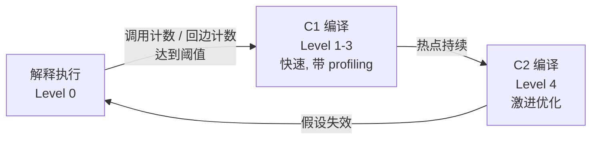
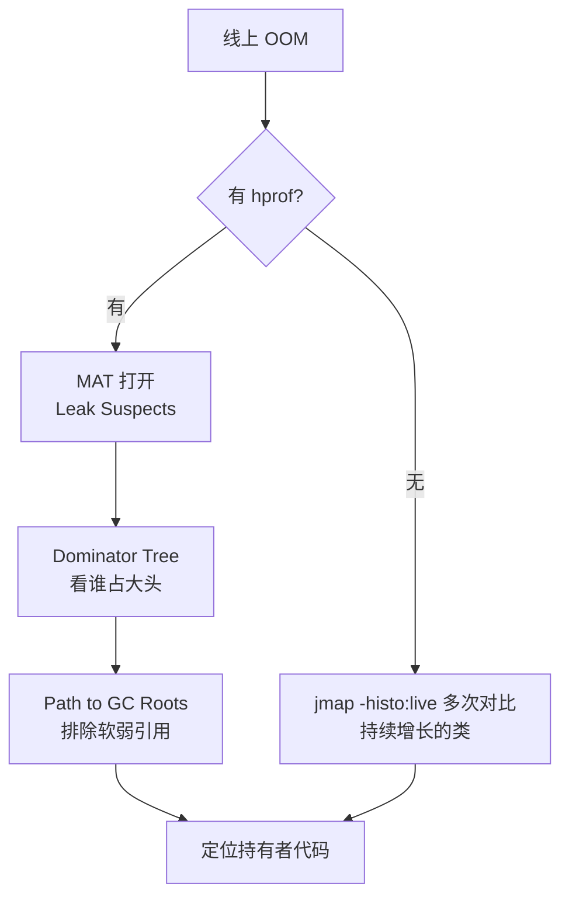

# 04 · JVM 虚拟机

> 理解运行机制，才能做性能调优。示例位于 `src/main/java/com/javalearning/jvm/`。
>
> 本章多数示例建议带 JVM 参数运行以观察差异，例如：
> `java -Xmx64m -Xlog:gc -cp target/classes com.javalearning.jvm.GcDemo`

| # | 知识点 | 示例代码 | 难度 |
|---|--------|----------|------|
| 4-1 | 类加载机制与双亲委派 | `ClassLoadingDemo` | ★★★ |
| 4-2 | 运行时数据区 | `RuntimeDataAreaDemo` | ★★ |
| 4-3 | 对象创建与内存布局 | `ObjectLayoutDemo` | ★★★ |
| 4-4 | 垃圾回收算法与收集器 | `GcDemo` | ★★★★ |
| 4-5 | JIT 即时编译与逃逸分析 | `JitDemo` | ★★★ |
| 4-6 | 字节码与 javap | `BytecodeDemo` | ★★★ |
| 4-7 | 性能调优工具 | `TuningToolsDemo` | ★★ |
| 4-8 | OOM 与内存泄漏排查 | `OomDemo` | ★★★ |

## 全景图



---

## 4-1 类加载机制与双亲委派

### 生命周期



- 准备阶段 `static int v = 1` 的 v 是 0；`static final int C = 1` 则直接是 1（ConstantValue 属性）。
- `<clinit>` 由 JVM 保证线程安全（这是静态内部类单例无需加锁的原因）。

### 初始化时机（主动引用）

`new`、读写静态字段（非常量）、调用静态方法、反射、初始化子类先初始化父类、`main` 所在类、`MethodHandle` 调用。
**被动引用不触发**：通过子类访问父类静态字段、定义数组、引用编译期常量。

### 双亲委派



- `loadClass` 先查缓存 → 委派父加载器 → 父加载失败才 `findClass` 自己加载。
- 好处：核心类不被篡改、同一个类只加载一次。
- 类的唯一性由 **加载器 + 全限定名** 共同决定，同一字节码被不同加载器加载得到不同 `Class`，彼此 `instanceof` 为 false。
- **打破委派的场景**：SPI（JDBC 驱动通过线程上下文类加载器加载）、Tomcat 每个 webapp 独立加载器、OSGi 模块化、热部署（丢弃旧加载器）。

**参考项目**：[apache/tomcat](https://github.com/apache/tomcat) 的 `WebappClassLoaderBase`；[alibaba/arthas](https://github.com/alibaba/arthas) 的 `redefine`。

---

## 4-2 运行时数据区

| 区域 | 线程 | 存放内容 | 异常 |
|------|------|----------|------|
| 程序计数器 | 私有 | 当前字节码行号 | 无 |
| 虚拟机栈 | 私有 | 栈帧（局部变量表、操作数栈、动态链接、返回地址） | `StackOverflowError` / OOM |
| 本地方法栈 | 私有 | Native 方法 | 同上 |
| 堆 | 共享 | 对象实例、数组 | `OutOfMemoryError: Java heap space` |
| 方法区（元空间） | 共享 | 类元信息、运行时常量池、静态变量（JDK 7 后移到堆） | `OutOfMemoryError: Metaspace` |
| 直接内存 | - | `DirectByteBuffer` | `OutOfMemoryError: Direct buffer memory` |



JDK 8 用元空间（本地内存）替代永久代：避免永久代大小难以设定导致的 OOM，字符串常量池与静态变量移入堆。

---

## 4-3 对象创建与内存布局



- 空对象 16 字节，`Integer` 16 字节，`int[10]` 56 字节。
- **分配方式**：指针碰撞（堆规整）/ 空闲列表（有碎片）；并发安全用 TLAB（每线程私有缓冲区）+ CAS。
- **逃逸分析**：对象不逃逸出方法 → 标量替换（拆成基本类型放寄存器）/ 栈上分配 / 锁消除。JDK 默认开启。
- 精确测量用 [openjdk/jol](https://github.com/openjdk/jol)。

---

## 4-4 垃圾回收算法与收集器

### 怎么判断对象死亡

可达性分析：从 GC Roots（栈局部变量、静态变量、常量、JNI 引用、活跃线程、锁对象）出发，不可达即可回收。引用计数法无法解决循环引用，JVM 不采用。

### 四种引用

| 引用 | 回收时机 | 用途 |
|------|----------|------|
| 强 | 永不（除非不可达） | 普通引用 |
| 软 `SoftReference` | 内存不足时 | 缓存 |
| 弱 `WeakReference` | 下次 GC | `WeakHashMap`、`ThreadLocal` key |
| 虚 `PhantomReference` | 回收时入队通知 | 堆外内存清理（Cleaner） |

### 算法



### 收集器演进

| 收集器 | 代 | 线程 | 特点 | 状态 |
|--------|----|------|------|------|
| Serial / Serial Old | 新 / 老 | 单 | 简单，客户端模式 | 可用 |
| Parallel Scavenge / Old | 新 / 老 | 多 | 吞吐优先 | JDK 8 默认 |
| CMS | 老 | 并发 | 低停顿，标记-清除有碎片 | JDK 14 移除 |
| **G1** | 整堆 Region 化 | 并发 | 可预测停顿 `-XX:MaxGCPauseMillis`，Mixed GC | JDK 9+ 默认 |
| **ZGC** | 整堆（JDK 21 分代） | 并发 | 着色指针 + 读屏障，停顿 < 1ms，TB 级堆 | JDK 15+ 生产 |
| Shenandoah | 整堆 | 并发 | Brooks 转发指针，低停顿 | JDK 12+ |

### G1 工作流程


**调优思路**：先开 `-Xlog:gc*` 看日志；Minor GC 频繁 → 调大新生代；Full GC 频繁 → 看是否晋升过早或泄漏；停顿敏感 → G1 调 `MaxGCPauseMillis` 或切 ZGC。

**参考项目**：[chewiebug/GCViewer](https://github.com/chewiebug/GCViewer) 日志可视化；[GCeasy](https://gceasy.io) 在线分析。

---

## 4-5 JIT 即时编译与逃逸分析



- **热点探测**：方法调用计数器 + 回边计数器（循环体），回边触发 **OSR**（栈上替换）让正在跑的循环切到编译代码。
- **关键优化**：方法内联（基础）、逃逸分析（标量替换 / 锁消除）、去虚拟化（内联缓存）、循环展开、范围检查消除。
- **去优化**：类层次假设被新加载的类打破时回退解释执行。
- **基准测试**必须预热，用 [openjdk/jmh](https://github.com/openjdk/jmh) 并通过 `Blackhole` 防止死代码消除。
- **AOT 路线**：GraalVM Native Image 启动快内存小，但失去运行时 profile；Spring Boot 3 / Quarkus 都支持。

---

## 4-6 字节码与 javap

### class 文件结构

```
magic(CAFEBABE) → minor/major version → constant_pool → access_flags
→ this_class / super_class → interfaces → fields → methods → attributes
```

### 操作数栈示例：`int c = a + b`

```
iload_0     // 把局部变量表 slot0 (a) 压栈
iload_1     // 把 slot1 (b) 压栈
iadd        // 弹出两个 int 相加，结果压栈
istore_2    // 弹出栈顶存入 slot2 (c)
```

### 五种方法调用指令

| 指令 | 用途 |
|------|------|
| `invokestatic` | 静态方法 |
| `invokespecial` | 构造器、私有方法、`super.` 调用 |
| `invokevirtual` | 普通实例方法（虚方法分派） |
| `invokeinterface` | 接口方法 |
| `invokedynamic` | Lambda、字符串拼接（Java 9+）、动态语言 |

常用命令：`javap -c -p -v Xxx.class`。字节码工程库：[ASM](https://asm.ow2.io/)、[ByteBuddy](https://github.com/raphw/byte-buddy)、Javassist。

---

## 4-7 性能调优工具

| 工具 | 用途 | 常用命令 |
|------|------|----------|
| `jps` | 列出 Java 进程 | `jps -l` |
| `jstat` | GC 统计 | `jstat -gcutil <pid> 1000` |
| `jstack` | 线程快照 | `jstack <pid> > t.txt` |
| `jmap` | 堆直方图 / dump | `jmap -histo:live <pid>`，`jmap -dump:live,format=b,file=h.hprof <pid>` |
| `jcmd` | 统一入口 | `jcmd <pid> GC.heap_info` |
| `jinfo` | 查看 / 改参数 | `jinfo -flags <pid>` |
| **Arthas** | 在线诊断 | `dashboard` `thread -n 3` `trace` `watch` `jad` `profiler` |
| JFR / JMC | 低开销飞行记录 | `-XX:StartFlightRecording=duration=60s,filename=a.jfr` |
| MAT / VisualVM | 堆分析 | Leak Suspects、Dominator Tree |

### CPU 飙高排查


**参考项目**：[alibaba/arthas](https://github.com/alibaba/arthas)、[async-profiler](https://github.com/async-profiler/async-profiler)（火焰图）。

---

## 4-8 OOM 与内存泄漏排查

### Java 的"泄漏"

对象不再使用却仍被引用，GC 无法回收。三大经典来源：

1. **静态集合**只增不减（缓存没有淘汰策略）→ 用 Caffeine / 弱引用 / LRU。
2. **ThreadLocal** 在线程池中不 `remove`。
3. **可变对象作 key**、**监听器 / 回调未注销**、**内部类持有外部引用**、未关闭的连接 / 流。

### 排查流程



**必配参数**：`-XX:+HeapDumpOnOutOfMemoryError -XX:HeapDumpPath=/data/dump -Xlog:gc*:file=gc.log`。

**参考项目**：[eclipse-mat](https://github.com/eclipse-mat/mat)；[Snailclimb/JavaGuide](https://github.com/Snailclimb/JavaGuide) JVM 专题。
