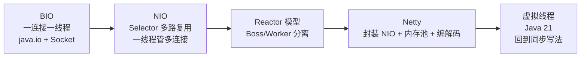
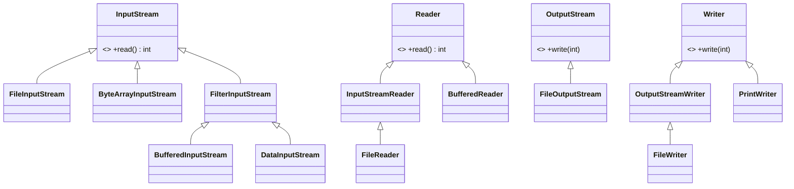
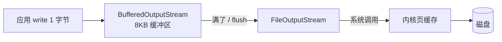
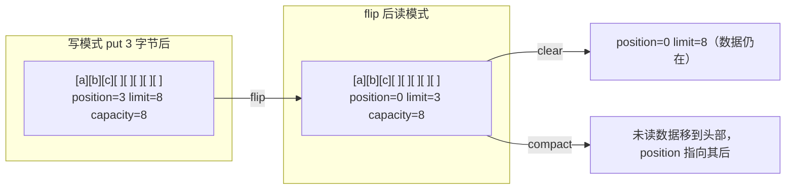
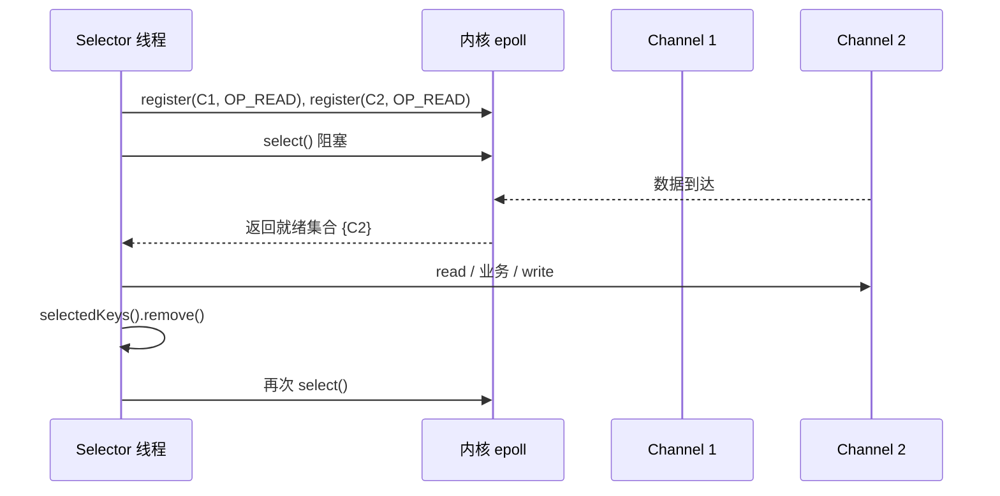
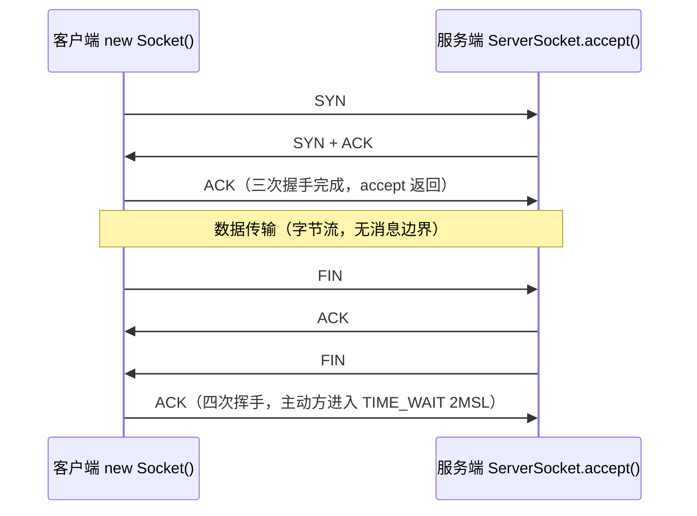
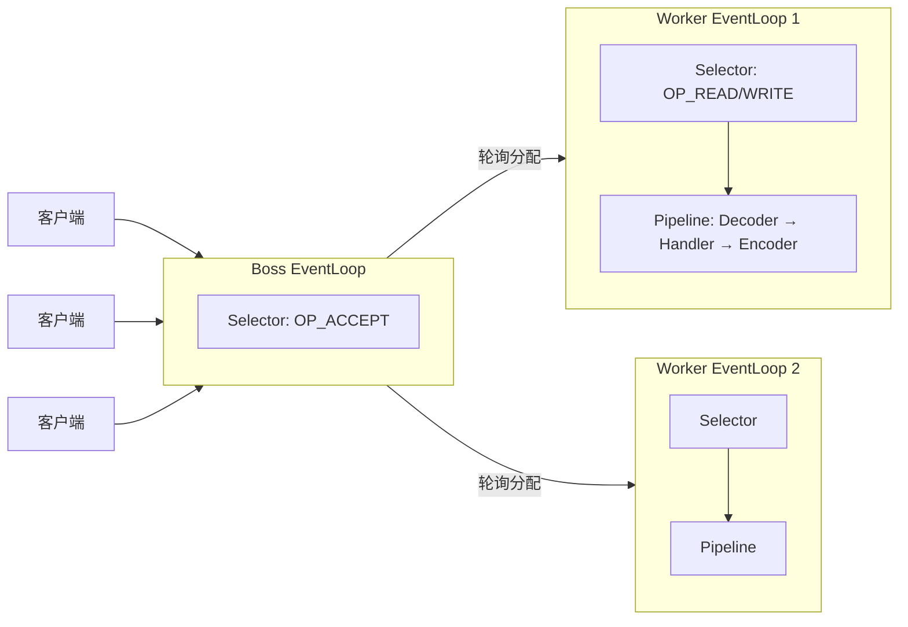

# 05 · IO 与网络

> 从阻塞 IO 到 Netty 的演进。示例位于 `src/main/java/com/javalearning/io/`，全部在本机回环地址上运行，无需外网。

| # | 知识点 | 示例代码 | 难度 |
|---|--------|----------|------|
| 5-1 | File / 字节流 / 字符流 | `FileStreamDemo` | ★ |
| 5-2 | 缓冲流与装饰器模式 | `BufferedDecoratorDemo` | ★★ |
| 5-3 | 序列化与反序列化 | `SerializationDemo` | ★★ |
| 5-4 | NIO：Channel / Buffer / Selector | `NioDemo` | ★★★ |
| 5-5 | Socket 与 TCP / HTTP | `SocketDemo` | ★★ |
| 5-6 | Reactor 模型与 Netty | `ReactorNettyDemo` | ★★★★ |
| 5-7 | 零拷贝 | `ZeroCopyDemo` | ★★★ |

## 演进脉络



---

## 5-1 File / 字节流 / 字符流



- **字节流**处理一切（图片、压缩包、class）；**字符流** = 字节流 + `Charset`，只用于文本。桥梁是 `InputStreamReader / OutputStreamWriter`。
- `read()` 返回 `int`（0~255 或 -1），所以能用 -1 表示 EOF。
- **乱码**根源：写入与读取编码不一致。Java 18 起默认 UTF-8（JEP 400），此前跟随操作系统。永远显式传 `StandardCharsets.UTF_8`。
- 优先使用 NIO.2 的 `Files / Path`：`readAllLines / readString / lines（流式）/ write / copy / move / walk / list`，失败抛带原因的异常。

---

## 5-2 缓冲流与装饰器模式



- 无缓冲的逐字节 `write` 每次都是一次系统调用（用户态→内核态切换），缓冲流把 8192 次合并成 1 次，实测快一到两个数量级。
- `java.io` 是**装饰器模式**的教科书：`FilterInputStream` 持有一个 `InputStream` 并转发，子类叠加功能，可任意嵌套：

```java
new GZIPInputStream(new BufferedInputStream(new FileInputStream(file)))
```

- 记得 `flush()`/`close()`，否则缓冲区中的数据丢失。

---

## 5-3 序列化与反序列化

| 规则 | 说明 |
|------|------|
| `implements Serializable` | 标记接口，无方法 |
| `serialVersionUID` | 显式声明，否则按类结构自动计算，改动即不兼容 |
| `transient` | 不序列化（密码、缓存、连接） |
| `static` | 属于类，不序列化 |
| 父类未实现 Serializable | 反序列化时调用父类**无参构造** |
| `readResolve()` | 控制反序列化返回的对象，保护单例 |
| `writeObject/readObject` | 自定义序列化逻辑 |

**为什么生产中几乎不用 Java 原生序列化**：体积大、慢、仅限 Java、**反序列化 RCE 漏洞**（`readObject` 会执行可达类代码）。Java 9+ 可用 `ObjectInputFilter` 白名单。

**替代方案**：JSON（Jackson）用于 HTTP；Protobuf / Avro 用于 RPC 与消息（带 schema，体积最小）；Hessian2 / Kryo 用于 Java 内部 RPC（Dubbo）。

**参考项目**：[FasterXML/jackson](https://github.com/FasterXML/jackson)、[protocolbuffers/protobuf](https://github.com/protocolbuffers/protobuf)、[EsotericSoftware/kryo](https://github.com/EsotericSoftware/kryo)。

---

## 5-4 NIO：Channel / Buffer / Selector

### Buffer 三指针



- `flip()`：写→读；`clear()`：重置指针准备写；`compact()`：保留未读数据继续写；`rewind()`：重读；`mark()/reset()`。
- **堆内缓冲** `allocate` vs **直接缓冲** `allocateDirect`（堆外，省一次拷贝，分配贵，需复用）。

### Selector 工作流程



- Channel 必须 `configureBlocking(false)` 才能注册。
- 四种事件：`OP_ACCEPT / OP_CONNECT / OP_READ / OP_WRITE`（写事件通常只在发送缓冲区满时临时注册）。
- 处理完必须从 `selectedKeys()` 移除，否则重复处理。
- 底层：Linux epoll、macOS kqueue、Windows IOCP（JDK 的 `WindowsSelectorImpl`）。

---

## 5-5 Socket 与 TCP / HTTP

### TCP 连接与 Socket API



### HTTP/1.1 报文

```
GET /api/users HTTP/1.1          ← 请求行
Host: localhost                  ← 头部
Accept: application/json
                                 ← 空行（\r\n）标志头结束
[请求体]

HTTP/1.1 200 OK                  ← 状态行
Content-Type: application/json
Content-Length: 27               ← 体的长度，解决"读到哪算完"
                                 
{"path":"/api/users"}            ← 响应体
```

- **粘包 / 拆包**：TCP 是字节流，应用层协议必须定义边界——固定长度、分隔符（HTTP 头的 `\r\n`）、长度前缀（Dubbo、gRPC）、`Content-Length` / `chunked`。
- Java 11 `HttpClient` 支持 HTTP/2、异步、WebSocket，取代 `HttpURLConnection`。
- 大量短连接 → `TIME_WAIT` 堆积、端口耗尽 → 使用 keep-alive / 连接池。

---

## 5-6 Reactor 模型与 Netty

### 主从 Reactor



示例 `ReactorNettyDemo` 用纯 NIO 实现了上述结构（1 Boss + 2 Worker），对应 Netty 的 `bossGroup` / `workerGroup`。

### Netty 核心概念

| 概念 | 作用 | 对应示例 |
|------|------|----------|
| `EventLoop` | 一个线程 + 一个 Selector + 任务队列 | `Worker.run` |
| `Channel` | 对 NIO Channel 的封装，绑定到一个 EventLoop | `SocketChannel` |
| `ChannelPipeline` | 责任链，入站 / 出站 Handler 顺序执行 | decode → toUpperCase → write |
| `ChannelHandler` | 编解码、业务逻辑、心跳、SSL | - |
| `ByteBuf` | 读写双指针、池化、堆外、引用计数（务必 `release`） | `ByteBuffer` |
| 编解码器 | `LengthFieldBasedFrameDecoder`、`HttpServerCodec`、`ProtobufDecoder` | - |

**Netty 为什么快**：主从 Reactor + 无锁串行化（一个 Channel 永远在同一个线程处理）+ 池化堆外 ByteBuf + 零拷贝（`CompositeByteBuf`、`FileRegion`）+ 解决 JDK epoll 空轮询 bug。

**参考项目**：[netty/netty](https://github.com/netty/netty)（从 `example/echo` 开始读）；基于 Netty 的 [apache/dubbo](https://github.com/apache/dubbo)、[apache/rocketmq](https://github.com/apache/rocketmq)、[grpc/grpc-java](https://github.com/grpc/grpc-java)。

---

## 5-7 零拷贝

```mermaid
flowchart TB
    subgraph 传统 read + write：4 次拷贝
        D1[(磁盘)] -- DMA --> K1[内核缓冲] -- CPU --> U1[用户缓冲] -- CPU --> S1[Socket 缓冲] -- DMA --> N1[网卡]
    end
    subgraph sendfile：2 次拷贝，CPU 不搬数据
        D2[(磁盘)] -- DMA --> K2[内核缓冲] -- DMA gather --> N2[网卡]
    end
```

| 技术 | Java API | 拷贝次数 | 适用 |
|------|----------|----------|------|
| mmap | `FileChannel.map` → `MappedByteBuffer` | 3 | 随机读写大文件（RocketMQ CommitLog、索引文件） |
| sendfile | `FileChannel.transferTo / transferFrom` | 2 | 文件 → socket（Kafka 消费、静态文件服务） |
| 直接内存 | `ByteBuffer.allocateDirect` | 省堆内→堆外一次 | 网络缓冲（Netty 池化） |

- `transferTo` 单次最多 2GB，需循环调用。
- 直接内存不受 `-Xmx` 限制，由 `-XX:MaxDirectMemorySize` 控制，释放依赖 `Cleaner`（虚引用），泄漏时表现为 `OutOfMemoryError: Direct buffer memory`。

**参考项目**：[apache/kafka](https://github.com/apache/kafka) 的 `FileRecords.writeTo`；[apache/rocketmq](https://github.com/apache/rocketmq) 的 `MappedFile`。
