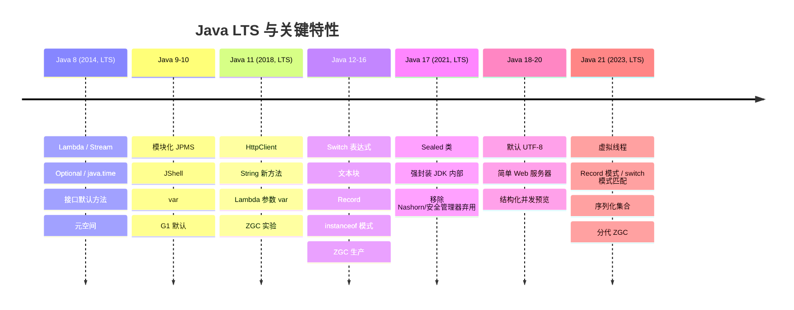
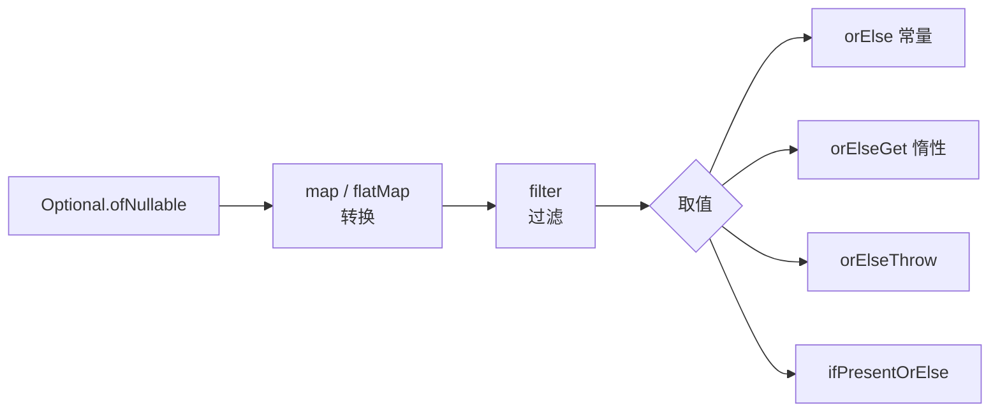
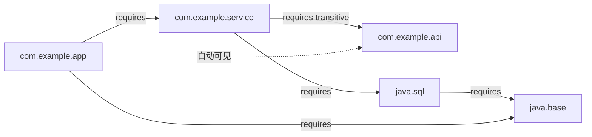
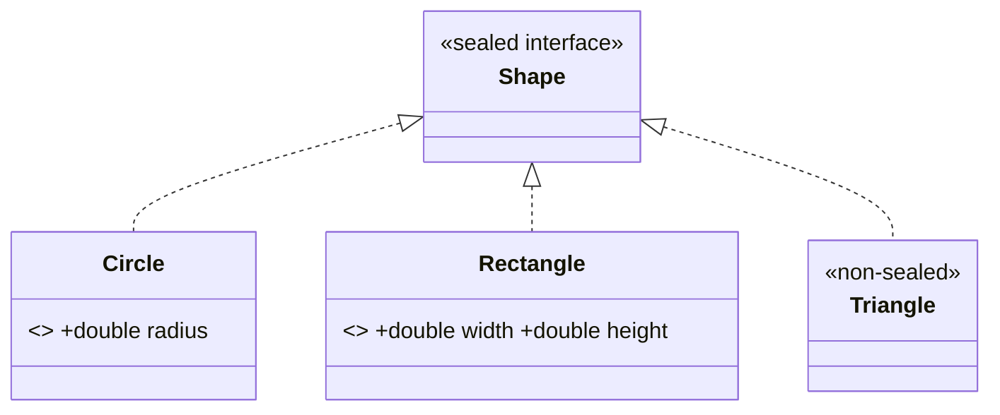
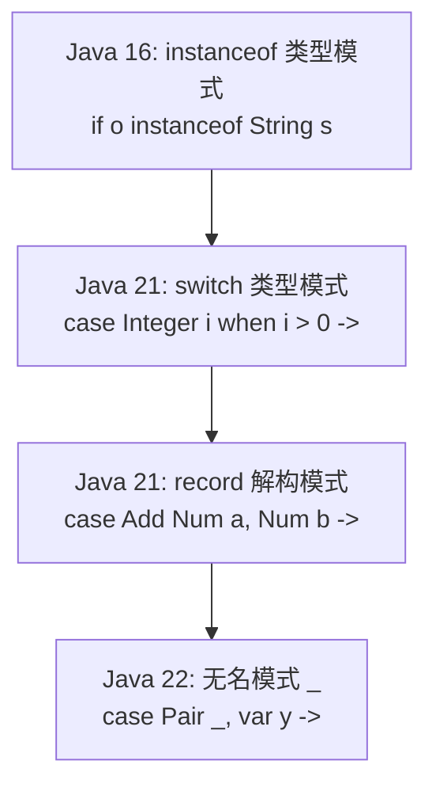
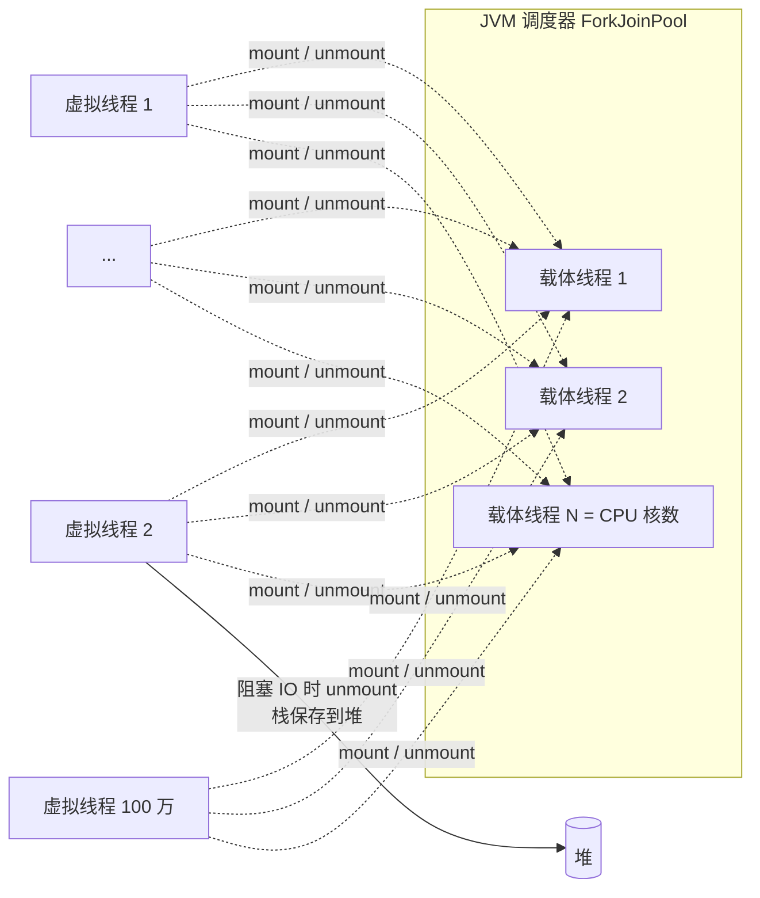

# 06 · Java 新特性（8 → 21）

> Java 8 到 Java 21 的语言演进。示例位于 `src/main/java/com/javalearning/modern/`，需要 JDK 21。

| # | 知识点 | 版本 | 示例代码 | 难度 |
|---|--------|------|----------|------|
| 6-1 | Lambda 与函数式接口 | 8 | `LambdaDemo` | ★★ |
| 6-2 | Optional 与新日期 API | 8 | `OptionalDateTimeDemo` | ★ |
| 6-3 | 模块化系统 JPMS | 9 | `ModuleSystemDemo` | ★★★ |
| 6-4 | var 局部类型推断 | 10 | `VarDemo` | ★ |
| 6-5 | Switch 表达式与文本块 | 14 / 15 | `SwitchTextBlockDemo` | ★ |
| 6-6 | Record / Sealed 类 | 16 / 17 | `RecordSealedDemo` | ★★ |
| 6-7 | 模式匹配 | 16 / 21 | `PatternMatchingDemo` | ★★★ |
| 6-8 | 虚拟线程 | 21 | `VirtualThreadDemo` | ★★★ |

## 版本时间线



迁移建议：8 → 11 关注 JPMS 强封装与移除的 JavaEE 模块（JAXB 等）；11 → 17 关注 `--illegal-access` 失效需 `--add-opens`；17 → 21 基本无痛，可直接享受虚拟线程。

---

## 6-1 Lambda 与函数式接口

| 接口 | 签名 | 常见用途 |
|------|------|----------|
| `Supplier<T>` | `() -> T` | 延迟创建、工厂 |
| `Consumer<T>` | `T -> void` | forEach、回调 |
| `Function<T,R>` | `T -> R` | map、转换 |
| `Predicate<T>` | `T -> boolean` | filter、校验 |
| `UnaryOperator<T>` | `T -> T` | replaceAll |
| `BinaryOperator<T>` | `(T,T) -> T` | reduce、merge |
| `BiFunction<T,U,R>` | `(T,U) -> R` | compute、构造器引用 |

- **方法引用四种形式**：`类::静态方法`、`类::实例方法`（首参为接收者）、`对象::方法`、`类::new`。
- **变量捕获**：局部变量必须 effectively final；Lambda 中 `this` 指外部实例，匿名类中 `this` 指匿名类本身。
- **实现机制**：`invokedynamic` + `LambdaMetafactory` 在运行时生成类，不产生 `Outer$1.class`。
- 组合：`Function.andThen/compose`、`Predicate.and/or/negate`、`Comparator.comparing().thenComparing().reversed()`。

**参考项目**：[vavr-io/vavr](https://github.com/vavr-io/vavr) 把函数式带得更远（不可变集合、Try、Either）。

---

## 6-2 Optional 与新日期 API

### Optional 用法速查



**规范**：只作返回值；不作字段 / 参数 / 集合元素；不要 `isPresent() + get()`；集合返回空集合而非 `Optional<List>`。

### java.time

| 类 | 含义 | 类比 |
|----|------|------|
| `LocalDate` / `LocalTime` / `LocalDateTime` | 无时区的"墙上时钟" | 生日、营业时间 |
| `Instant` | UTC 时间线上的点（epoch 纳秒） | 数据库时间戳、日志 |
| `ZonedDateTime` / `OffsetDateTime` | 带时区 / 偏移 | 跨区会议、航班 |
| `Period` | 日期间隔（年月日） | 年龄 |
| `Duration` | 时间间隔（秒纳秒） | 超时、耗时 |
| `DateTimeFormatter` | 不可变线程安全格式化 | 替代 `SimpleDateFormat` |

陷阱：`YYYY`（周年）vs `yyyy`；`hh`（12 小时）vs `HH`；存储用 `Instant`/UTC，展示时转时区。

---

## 6-3 模块化系统 JPMS



| 指令 | 含义 |
|------|------|
| `requires M` | 依赖模块 |
| `requires transitive M` | 传递依赖，使用者自动可见 |
| `requires static M` | 仅编译期（如 Lombok、注解处理器） |
| `exports P [to M]` | 公开包（仅 public 类型，编译期+运行期） |
| `opens P [to M]` | 允许运行时深度反射（JPA/Jackson/Spring 需要） |
| `uses S` / `provides S with Impl` | SPI 消费 / 提供 |

- **强封装**：Java 16 起 `--illegal-access` 默认 deny；反射 JDK 内部需 `--add-opens java.base/java.lang=ALL-UNNAMED`。
- **三类模块**：命名模块、自动模块（模块路径上无 `module-info` 的 jar）、未命名模块（类路径）。
- **jlink** 定制最小运行时，Docker 镜像可从 300MB 瘦到 50MB；**jdeps** 分析依赖。
- 现实：业务项目大多仍在类路径上；库至少提供 `Automatic-Module-Name`。

---

## 6-4 var 局部类型推断

- 编译期推断，**不是动态类型**；推断自初始化表达式，之后不可变更类型。
- `var list = new ArrayList<>()` 推断为 `ArrayList<Object>`；想要接口类型就显式写。
- 不能用于：字段、参数、返回值、`null` 初始化、Lambda 直接赋值、数组初始化、复合声明。
- Java 11 允许 `(var x) -> ...` 以便给 Lambda 参数加注解。
- 可读性原则：右侧类型明显时用；否则写出类型；用好变量名。

---

## 6-5 Switch 表达式与文本块

```java
String type = switch (day) {
    case SATURDAY, SUNDAY -> "周末";
    case WEDNESDAY -> { yield "小周末"; }
    default -> "工作日";
};
```

- 箭头形式不穿透、无需 `break`、可作为表达式；覆盖所有枚举值可省 `default`，新增枚举值即编译错误。
- 文本块 `"""`：保留换行与相对缩进，公共缩进按最靠左的非空行（含结束引号）剥离；`\` 续行、`\s` 保留空格、`formatted()` 填充。适合 SQL / JSON / HTML。

---

## 6-6 Record / Sealed 类



**Record**：透明不可变数据载体，自动生成构造器 / 访问器 / `equals` / `hashCode` / `toString`；紧凑构造器做校验；可实现接口、可泛型、可有静态成员和方法；不能有实例字段、不能被继承。适合 DTO、值对象、Map 复合 key、多返回值。

**Sealed**：`permits` 限定直接子类，子类必须 `final` / `sealed` / `non-sealed`。与 record 组合 = 代数数据类型（record 是积类型，sealed 是和类型），让 switch 获得**穷尽性检查**。

**参考项目**：Spring Framework 6 / Jackson 2.12+ 原生支持 record；[spring-projects/spring-data-commons](https://github.com/spring-projects/spring-data-commons) 的 record 投影。

---

## 6-7 模式匹配



- **流程作用域**：`if (!(o instanceof String s)) return; s.length();` 合法。
- **守卫** `when`、`case null`、`case null, default`。
- **支配性**：更具体的模式必须在前；**穷尽性**：表达式 switch 必须覆盖全部（sealed 可省 default）。
- **record 模式**可嵌套任意深、可用 `var`。示例用它写了一个表达式树求值器 + 化简器，替代了传统 Visitor 模式。

---

## 6-8 虚拟线程



| | 平台线程 | 虚拟线程 |
|---|---|---|
| 实现 | 1:1 映射 OS 线程 | M:N，JVM 调度 |
| 创建成本 | ~1MB 栈、毫秒级 | 几百字节起、微秒级 |
| 数量 | 数千 | 数百万 |
| 阻塞 | 占用 OS 线程 | 自动让出载体线程 |
| 适用 | CPU 密集 | IO 密集、每请求一线程 |

**使用准则**

1. `Executors.newVirtualThreadPerTaskExecutor()`，每任务一线程，**不要池化**。
2. Java 21 中 `synchronized` 块内阻塞会 **pinning** 载体线程 → 改用 `ReentrantLock`（Java 24 JEP 491 已解决）。`-Djdk.tracePinnedThreads=full` 可定位。
3. 慎用 `ThreadLocal`（百万线程内存可观），考虑 `ScopedValue`。
4. CPU 密集任务不会更快。
5. Spring Boot 3.2+：`spring.threads.virtual.enabled=true`。

示例实测：10 万个 10ms 阻塞任务，200 平台线程池 ≈ 5 s，虚拟线程 ≈ 0.3 s。

**参考项目**：[openjdk/loom](https://github.com/openjdk/loom)；Spring Boot 3.2 虚拟线程支持；[helidon-io/helidon](https://github.com/helidon-io/helidon) 4.x 完全基于虚拟线程的 Web 服务器。
