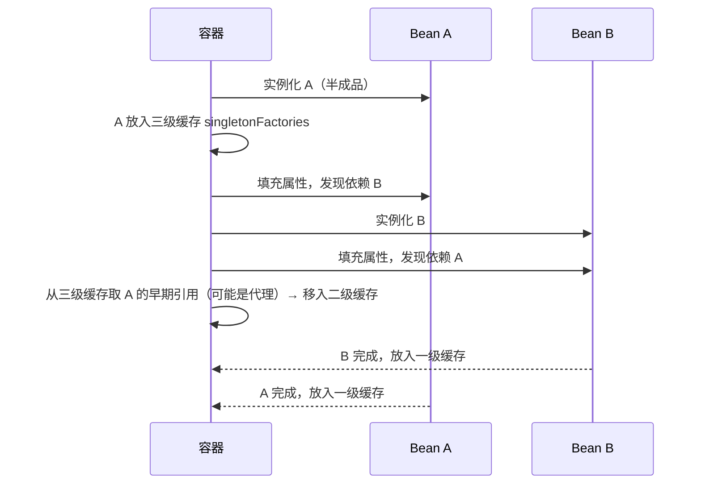
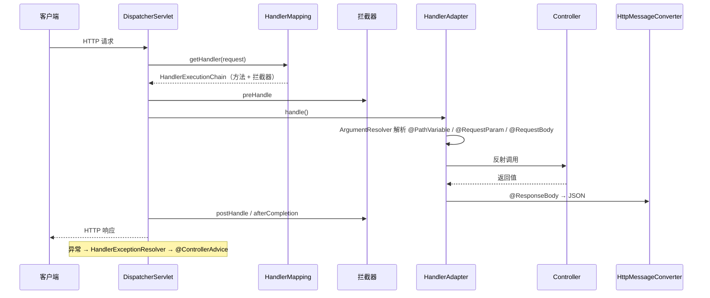
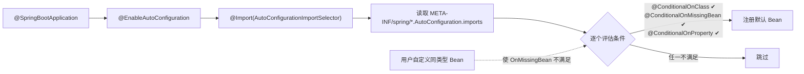
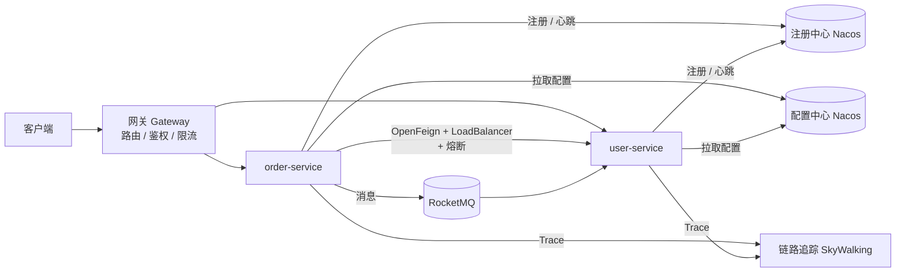
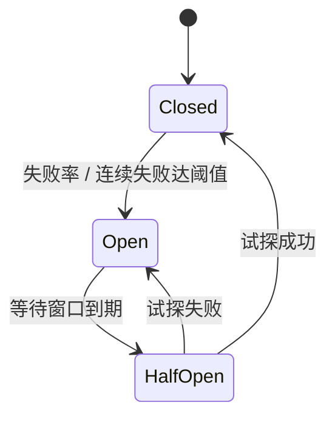
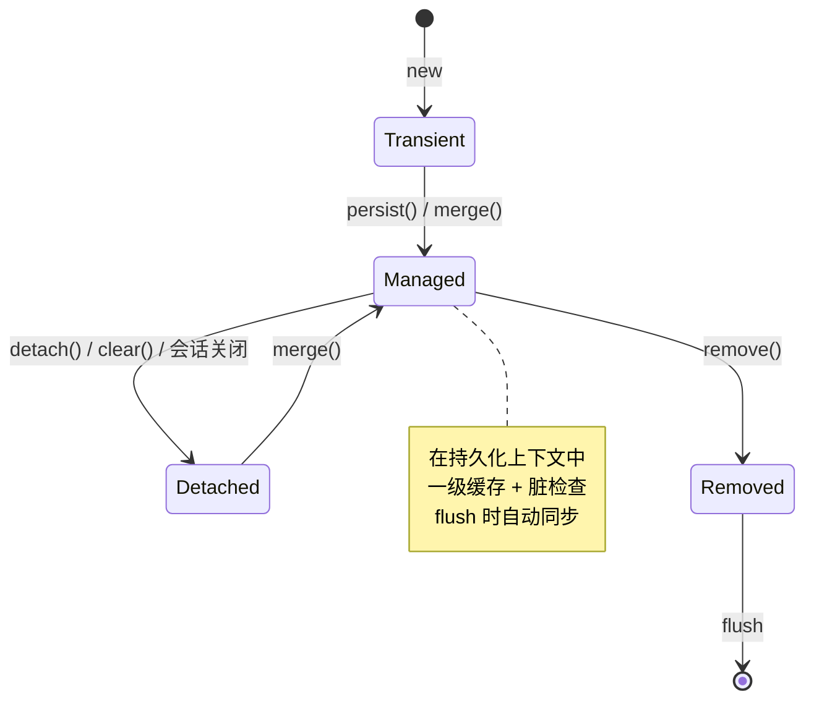

# 07 · 主流框架

> 企业级开发的事实标准。本章示例**不依赖 Spring**，而是用几十到一百多行代码手写每个框架的核心机制——
> 看懂迷你实现后再读真实源码，会发现只是多了边界处理与扩展点。示例位于 `src/main/java/com/javalearning/frameworks/`。

| # | 知识点 | 示例代码 | 迷你实现了什么 |
|---|--------|----------|----------------|
| 7-1 | Spring：IoC / DI / AOP / 事务 | `MiniIocAopDemo` | 容器 + 字段注入 + 二级缓存 + BeanPostProcessor + 事务代理 |
| 7-2 | Spring MVC 请求处理流程 | `MiniMvcDemo` | DispatcherServlet：路由、参数解析、拦截器、异常处理、JSON 返回 |
| 7-3 | Spring Boot 自动装配 / Starter | `AutoConfigurationDemo` | 条件装配、用户 Bean 优先、属性绑定 |
| 7-4 | Spring Cloud 微服务组件 | `CloudComponentsDemo` | 注册中心、负载均衡、熔断器状态机、网关 |
| 7-5 | MyBatis / MyBatis-Plus | `MiniMyBatisDemo` | Mapper 动态代理、`#{}` 预编译、结果映射、一级缓存（H2 真实执行） |
| 7-6 | JPA / Hibernate | `JpaConceptsDemo` | 实体状态、一级缓存、脏检查、N+1 与 JOIN FETCH |
| 7-7 | Spring Security / Shiro | `SecurityFilterChainDemo` | 过滤器链、PBKDF2 密码、HMAC Token、角色授权 |

---

## 7-1 Spring 核心：IoC / DI / AOP / 事务

### Bean 生命周期

```mermaid
flowchart TD
    A[扫描 @Component<br/>生成 BeanDefinition] --> B[实例化<br/>反射调用构造器]
    B --> C[属性填充 populateBean<br/>@Autowired / @Value]
    C --> D[Aware 回调<br/>BeanNameAware / ApplicationContextAware]
    D --> E[BeanPostProcessor<br/>postProcessBeforeInitialization]
    E --> F[初始化<br/>@PostConstruct / InitializingBean / init-method]
    F --> G[BeanPostProcessor<br/>postProcessAfterInitialization<br/>AOP 在此返回代理]
    G --> H[放入单例池<br/>singletonObjects]
    H --> I[使用]
    I --> J[销毁<br/>@PreDestroy / DisposableBean]
```

### 三级缓存解决循环依赖



只能解决**单例 + 字段/setter 注入**的循环依赖；构造器注入或 prototype 作用域会抛 `BeanCurrentlyInCreationException`。

### AOP

- 实现：JDK 动态代理（有接口）或 CGLIB 子类代理（Spring Boot 默认 `proxyTargetClass=true`）。
- 术语：切面 Aspect、连接点 JoinPoint、切点 Pointcut、通知 Advice（Before / After / Around / AfterReturning / AfterThrowing）、织入 Weaving。
- 入口：`AbstractAutoProxyCreator` 是一个 `BeanPostProcessor`，在 `postProcessAfterInitialization` 返回代理对象。

### @Transactional 失效场景

| 场景 | 原因 |
|------|------|
| 同类内部调用 `this.method()` | 绕过了代理 |
| 方法非 `public` | 代理不拦截 |
| 异常被 `catch` 吞掉 | 拦截器看不到异常 |
| 抛出受检异常 | 默认只回滚 `RuntimeException` / `Error`，需 `rollbackFor = Exception.class` |
| 新线程中执行 | 事务绑定在 `ThreadLocal` |
| 传播级别 `NOT_SUPPORTED` / 存储引擎不支持 | 配置问题 |

**参考项目**：[spring-projects/spring-framework](https://github.com/spring-projects/spring-framework)（`AbstractAutowireCapableBeanFactory.doCreateBean`）；精简版 [code4craft/tiny-spring](https://github.com/code4craft/tiny-spring)、[DerekYRC/mini-spring](https://github.com/DerekYRC/mini-spring)。

---

## 7-2 Spring MVC 请求处理流程



- **Filter vs Interceptor**：Filter 属于 Servlet 容器，更早执行，拿不到 Handler 信息；Interceptor 属于 Spring，可访问 `HandlerMethod`。
- 参数绑定依赖 `-parameters` 编译参数保留形参名（Spring 6.1 起不再回退到字节码调试信息）。
- `@RestController` = `@Controller` + `@ResponseBody`。
- WebFlux 用 `DispatcherHandler` + Reactor，编程模型相似但底层非阻塞。

---

## 7-3 Spring Boot 自动装配 / Starter



- **Starter 的本质**：`xxx-spring-boot-starter`（依赖聚合 pom）+ `xxx-spring-boot-autoconfigure`（`@AutoConfiguration` 类 + `@ConfigurationProperties`）。
- **条件注解**：`OnClass / OnMissingClass / OnBean / OnMissingBean / OnProperty / OnWebApplication / OnExpression`。
- **调试**：启动参数 `--debug` 打印 CONDITIONS EVALUATION REPORT；Actuator `/actuator/conditions`。
- **配置优先级**（高→低）：命令行 > 环境变量 > `application-{profile}.yml` > `application.yml` > 默认值。

**参考项目**：[spring-projects/spring-boot](https://github.com/spring-projects/spring-boot) 的 `spring-boot-autoconfigure` 模块；[mybatis/spring-boot-starter](https://github.com/mybatis/spring-boot-starter) 是一个写得很规范的第三方 starter。

---

## 7-4 Spring Cloud 微服务组件



### 熔断器状态机



| 能力 | 推荐组件 | 已淘汰 |
|------|----------|--------|
| 注册 / 配置中心 | Nacos | Eureka（维护模式） |
| 负载均衡 | Spring Cloud LoadBalancer | Ribbon |
| 声明式调用 | OpenFeign / Spring 6 HTTP Interface | - |
| 熔断限流 | Sentinel / Resilience4j | Hystrix |
| 网关 | Spring Cloud Gateway | Zuul 1 |
| 分布式事务 | Seata | - |
| 链路追踪 | Micrometer Tracing + SkyWalking / Zipkin | Sleuth |

**参考项目**：[alibaba/spring-cloud-alibaba](https://github.com/alibaba/spring-cloud-alibaba)、[alibaba/nacos](https://github.com/alibaba/nacos)、[alibaba/Sentinel](https://github.com/alibaba/Sentinel)、[macrozheng/mall-swarm](https://github.com/macrozheng/mall-swarm)（完整电商微服务实战）。

---

## 7-5 MyBatis / MyBatis-Plus

```mermaid
flowchart LR
    M[Mapper 接口] -- 动态代理 --> P[MapperProxy]
    P --> S[SqlSession]
    S --> E[Executor<br/>Simple / Reuse / Batch<br/>CachingExecutor 装饰]
    E --> SH[StatementHandler<br/>生成 PreparedStatement]
    SH --> PH[ParameterHandler<br/>#{} 设参]
    SH --> RH[ResultSetHandler<br/>结果映射]
    PL[插件 Interceptor<br/>分页 / 慢 SQL / 加密] -. 代理拦截 .-> E & SH & PH & RH
```

- `#{}` 预编译（安全）vs `${}` 字符串拼接（表名/排序字段，需白名单）。
- 一级缓存：`SqlSession` 级，Spring 下每次请求新 Session 几乎无效；二级缓存：Mapper 级，分布式下有脏读风险，生产少用。
- 动态 SQL：`<if> <where> <set> <foreach> <choose>`。
- MyBatis-Plus：`BaseMapper` 通用 CRUD、`LambdaQueryWrapper` 类型安全条件、分页插件、乐观锁、逻辑删除、自动填充、代码生成器。

**参考项目**：[mybatis/mybatis-3](https://github.com/mybatis/mybatis-3)（从 `MapperProxy` → `MapperMethod` → `DefaultSqlSession` 读起）；[baomidou/mybatis-plus](https://github.com/baomidou/mybatis-plus)。

---

## 7-6 JPA / Hibernate

### 实体状态



- **一级缓存**：同一会话同 id 返回同一实例，不重复查库。
- **脏检查**：加载时保存快照，flush 时比对差异自动生成 `UPDATE`——所以"只改字段不调 save 也会更新"。
- **N+1**：查 N 条主记录后访问懒加载关联触发 N 次查询。解法：`JOIN FETCH`、`@EntityGraph`、`@BatchSize`、`default_batch_fetch_size`。
- **LazyInitializationException**：会话关闭后访问懒加载属性；不要靠 Open-Session-In-View 掩盖，应在服务层加载完整数据或返回 DTO。
- Spring Data JPA：方法名派生查询、`@Query`、`Specification`、`Pageable`、审计 `@CreatedDate`。

**MyBatis vs JPA**：SQL 可控 / 复杂报表 → MyBatis；领域模型清晰 / 快速 CRUD → JPA。

**参考项目**：[hibernate/hibernate-orm](https://github.com/hibernate/hibernate-orm)、[spring-projects/spring-data-jpa](https://github.com/spring-projects/spring-data-jpa)。

---

## 7-7 Spring Security / Shiro

```mermaid
flowchart LR
    R[请求] --> F1[SecurityContextHolderFilter]
    F1 --> F2[认证过滤器<br/>UsernamePassword / BearerToken]
    F2 --> F3[ExceptionTranslationFilter<br/>401 / 403 转换]
    F3 --> F4[AuthorizationFilter<br/>URL 规则]
    F4 --> C[Controller<br/>@PreAuthorize 方法级]
    F2 -. 认证 .-> AM[AuthenticationManager]
    AM --> AP[DaoAuthenticationProvider]
    AP --> UDS[UserDetailsService]
    AP --> PE[PasswordEncoder]
```

- **认证 vs 授权**：认证回答"你是谁"（401），授权回答"你能做什么"（403）。
- **密码**：使用慢哈希 BCrypt / Argon2 / PBKDF2 + 随机盐；`DelegatingPasswordEncoder` 用 `{bcrypt}` 前缀支持算法升级；比较用常量时间防时序攻击。
- **Session vs JWT**：Session 服务端有状态，需 CSRF 防护；JWT 无状态易扩展，但无法主动失效，需短期 Access + Refresh Token 或黑名单。
- **OAuth2 / OIDC**：授权码 + PKCE 是现代标准；Spring Authorization Server / Keycloak 作授权服务器。
- **Shiro**：`Subject / SecurityManager / Realm`，轻量，适合非 Spring 或简单 RBAC。

**参考项目**：[spring-projects/spring-security](https://github.com/spring-projects/spring-security)；[spring-projects/spring-security-samples](https://github.com/spring-projects/spring-security-samples)；[apache/shiro](https://github.com/apache/shiro)。
