# 08 · 数据库与中间件

> 后端工程师的"外部依赖"知识。本章示例**不需要安装任何中间件**：MySQL 相关用 H2 内存库真实执行 SQL，
> Redis / MQ / ES / 分库分表 / 缓存一致性则用几十到两百行 Java 手写其核心机制。
> 看懂迷你实现，再去用真实组件时就知道配置项背后在调什么。示例位于 `src/main/java/com/javalearning/middleware/`。

| # | 知识点 | 示例代码 | 演示内容 | 难度 |
|---|--------|----------|----------|------|
| 8-1 | JDBC 与连接池 | `JdbcConnectionPoolDemo` | JDBC 四步、PreparedStatement 防注入、事务回滚、批处理、手写连接池 | ★★ |
| 8-2 | MySQL：索引 / 事务 / 锁 | `MysqlIndexTxDemo` | 20 万行有无索引耗时对比、索引失效、最左前缀、不可重复读、行锁等待 | ★★★ |
| 8-3 | Redis | `RedisDemo` | 五种结构、过期策略、LRU 淘汰、SETNX 锁、AOF 重放 | ★★★ |
| 8-4 | 消息队列 | `MessageQueueDemo` | 分区有序、消费组、至少一次 + 幂等、延迟消息 | ★★★ |
| 8-5 | Elasticsearch | `ElasticsearchDemo` | 倒排索引、TF-IDF/BM25 评分、bool 查询、聚合、分片路由 | ★★★ |
| 8-6 | 分库分表 | `ShardingDemo` | SQL 改写路由、基因法、一致性哈希迁移量、雪花 ID | ★★★★ |
| 8-7 | 分布式缓存一致性 | `CacheConsistencyDemo` | 用线程交错复现 3 种更新策略的不一致、延迟双删、击穿互斥、布隆过滤器 | ★★★★ |

---

## 8-1 JDBC 与连接池（HikariCP / Druid）

### JDBC 标准流程

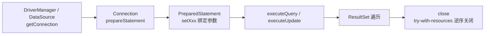

- `Statement` 拼接 SQL 字符串 → SQL 注入；`PreparedStatement` 把 SQL 模板和参数分开发给数据库，参数永远是"值"。
- `conn.setAutoCommit(false)` 开启事务；异常时 `rollback()`，务必在 `finally` 恢复 `autoCommit`。
- 批处理 `addBatch()/executeBatch()`，MySQL 还需要 URL 参数 `rewriteBatchedStatements=true` 才会真正合并成多值 INSERT。

### 连接池的核心模型

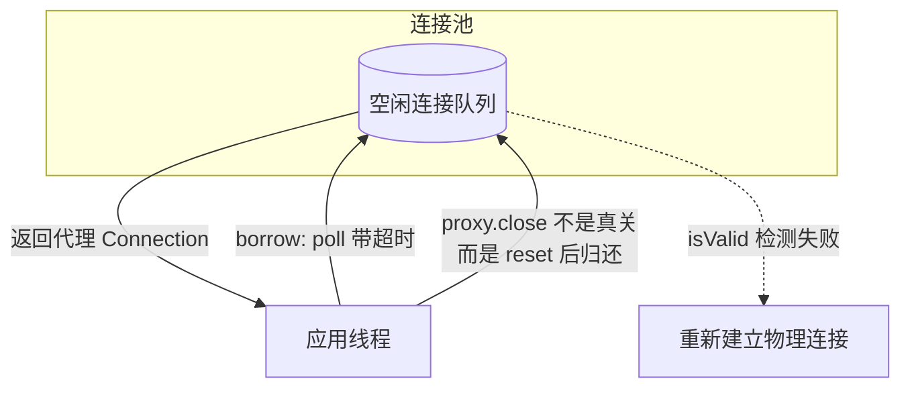

示例 `MiniPool` 用 `ArrayBlockingQueue` 保存物理连接，借出时套一层 JDK 动态代理拦截 `close()`，归还前回滚未提交事务——这就是 HikariCP 的 `ProxyConnection` 做的事。

| 参数（HikariCP） | 含义 | 建议 |
|------------------|------|------|
| `maximumPoolSize` | 最大连接数 | `CPU 核数 * 2 + 磁盘数`，Web 应用常 10~20，不是越大越好 |
| `minimumIdle` | 最小空闲 | 默认等于 max（固定大小池最稳定） |
| `connectionTimeout` | 借连接等待超时 | 默认 30s，建议调小快速失败 |
| `maxLifetime` | 连接最大存活 | 比 MySQL `wait_timeout` 少 30s 以上，避免拿到被服务端踢掉的连接 |
| `leakDetectionThreshold` | 泄漏检测 | 开发环境开 2s，定位忘记 close 的代码 |

### 面试题 / 陷阱

- 为什么 HikariCP 快：ConcurrentBag 无锁 + ThreadLocal 亲和、FastList、Javassist 生成代理、代码精简。
- Druid 的优势是监控与 SQL 防火墙，不是性能。
- Spring 中同一事务如何保证用同一个连接：`DataSourceUtils` + `TransactionSynchronizationManager` 把连接绑定到 ThreadLocal。

---

## 8-2 MySQL：索引 / 事务 / 锁 / 调优

### B+ 树为什么适合做数据库索引

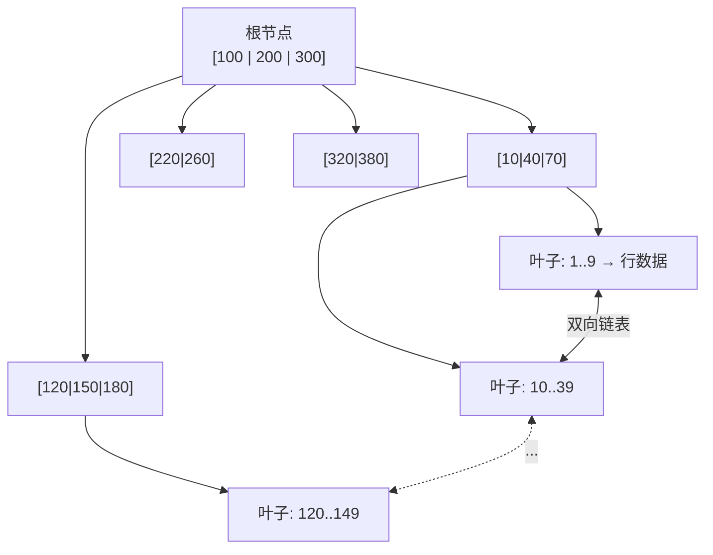

- 每个节点是一个 16KB 页，可容纳上千个键，三层即可存千万级数据，一次查询只需 2~3 次磁盘 IO。
- 叶子节点间双向链表 → 范围查询、排序直接顺序扫描。
- InnoDB **聚簇索引**叶子存整行；**二级索引**叶子存主键 → 查非索引列要"回表"；若查询列都在索引中则"覆盖索引"。

### 索引失效的常见情况

| 写法 | 原因 |
|------|------|
| `WHERE YEAR(created) = 2024` | 索引列参与函数/运算 |
| `WHERE name LIKE '%abc'` | 前导通配符无法利用有序性 |
| `WHERE phone = 13800000000`（phone 是 varchar） | 隐式类型转换等价于对列做函数 |
| 复合索引 `(a, b)` 却只 `WHERE b = ?` | 违反最左前缀 |
| `WHERE a = 1 OR c = 2`（c 无索引） | OR 一侧无索引则整体放弃 |
| 小表、低区分度列（性别） | 优化器估算全表扫描更快 |

示例在 20 万行上实测：无索引约 7ms，有索引约 0.2ms；`user_id + 0 = ?` 回到 10ms 级。

### 事务与 MVCC

```mermaid
sequenceDiagram
    participant T1 as 事务1 (RR)
    participant DB as InnoDB
    participant T2 as 事务2
    T1->>DB: SELECT amount WHERE id=1 → 建立 ReadView，读到 100
    T2->>DB: UPDATE amount=999 WHERE id=1; COMMIT
    Note over DB: 旧版本 100 仍保留在 undo log 链上
    T1->>DB: 再次 SELECT → 沿 roll_pointer 找到对 ReadView 可见的版本 100
    Note over T1: 可重复读；若隔离级别是 RC 则每次 SELECT 新建 ReadView，读到 999
```

| 隔离级别 | 脏读 | 不可重复读 | 幻读 | InnoDB 实现 |
|----------|------|-----------|------|-------------|
| READ UNCOMMITTED | 有 | 有 | 有 | 直接读最新 |
| READ COMMITTED | 无 | 有 | 有 | 每条语句新建 ReadView |
| REPEATABLE READ（默认） | 无 | 无 | 基本无 | 事务首次读建 ReadView + 间隙锁 |
| SERIALIZABLE | 无 | 无 | 无 | 读加共享锁 |

日志三兄弟：**undo log**（回滚 + MVCC 旧版本）、**redo log**（WAL 崩溃恢复，保证持久性）、**binlog**（Server 层逻辑日志，主从复制与数据恢复）。redo 与 binlog 用两阶段提交保持一致。

### 锁

- 行锁加在**索引记录**上：`UPDATE ... WHERE 无索引列` 会锁全表。
- Record Lock / Gap Lock / Next-Key Lock（左开右闭区间）；RR 下用 Next-Key 防止幻读。
- 死锁：InnoDB 自动检测（wait-for graph）回滚代价小者；避免方式是固定加锁顺序、小事务、索引精准。
- 示例 `rowLockDemo` 实测事务 2 被阻塞约 500ms 直到事务 1 提交。

### 调优路径

慢查询日志（`long_query_time`）→ `EXPLAIN`（看 `type`、`key`、`rows`、`Extra`）→ 加/调整索引 → 改写 SQL（避免 `SELECT *`、深分页用 `WHERE id > ? LIMIT n`、大事务拆小）→ 架构层（读写分离、缓存、分库分表）。

参考：[MySQL 实战 45 讲](https://time.geekbang.org/column/intro/100020801)、《高性能 MySQL》、[alibaba/druid](https://github.com/alibaba/druid)、[brettwooldridge/HikariCP](https://github.com/brettwooldridge/HikariCP)。

---

## 8-3 Redis：数据结构 / 缓存 / 持久化

### 数据结构与典型用途

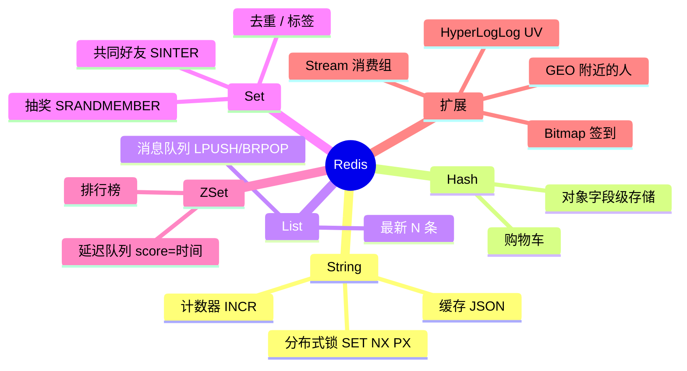

示例 `MiniRedis` 用 `LinkedHashMap(accessOrder=true)` 实现 LRU，用 `TreeMap + HashMap` 实现 ZSet（对应 Redis 的 skiplist + dict 双结构：按分数范围查用跳表，按成员查分数用字典）。

### 过期与淘汰

- 过期删除：**惰性删除**（访问时检查）+ **定期删除**（每秒 10 次随机抽样 20 个键，过期比例 > 25% 则重复）。
- 内存淘汰 `maxmemory-policy`：`noeviction`（默认，写报错）、`allkeys-lru`（缓存场景常用）、`volatile-lru`、`allkeys-lfu`、`volatile-ttl`、`random`。Redis 的 LRU 是采样近似算法。

### 持久化

| | RDB | AOF |
|--|-----|-----|
| 原理 | fork 子进程写内存快照（COW） | 追加写命令日志 |
| 文件 | 小，恢复快 | 大，恢复慢（有 AOF 重写） |
| 数据丢失 | 两次快照之间 | `appendfsync everysec` 最多丢 1s |
| Redis 7 | 混合持久化：RDB 头 + 增量 AOF 尾 | |

示例把所有写命令记入 `aof` 列表，再用一个新实例 `replay()` 恢复出完全一致的状态。

### 分布式锁的正确姿势

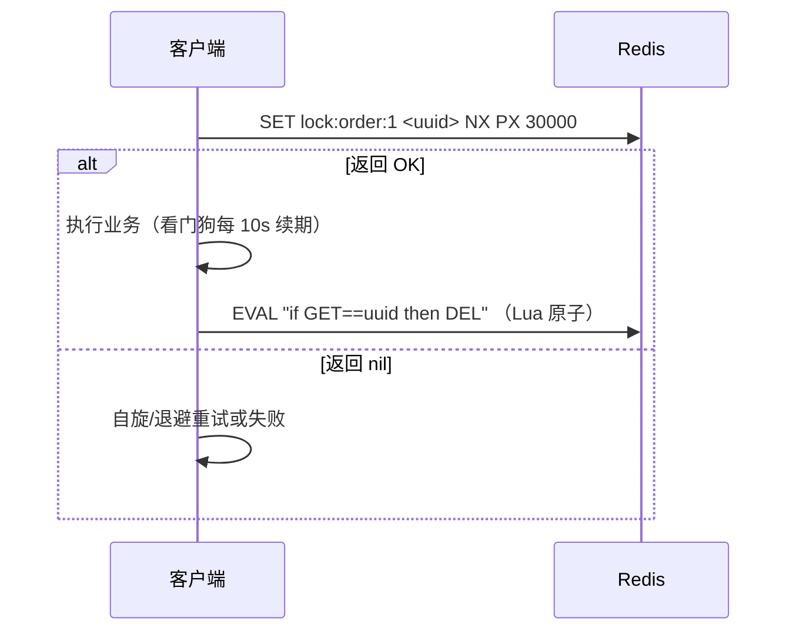

坑：不加过期 → 死锁；不比对 value 直接 DEL → 误删别人的锁；业务超过过期时间 → 锁提前释放（Redisson 看门狗解决）；主从异步复制切换时锁丢失（RedLock 方案与争议）。

### 缓存三问题

| 问题 | 现象 | 解决 |
|------|------|------|
| 穿透 | 查不存在的 key，缓存与 DB 都没有 | 缓存空值 / 布隆过滤器（见 8-7） |
| 击穿 | 热点 key 过期瞬间大量请求打到 DB | 互斥锁重建 / 逻辑过期 |
| 雪崩 | 大量 key 同时过期或 Redis 宕机 | 过期时间加随机、多级缓存、集群、限流降级 |

参考：《Redis 设计与实现》、[redis/redis](https://github.com/redis/redis)、[redisson/redisson](https://github.com/redisson/redisson)。

---

## 8-4 消息队列：Kafka / RocketMQ / RabbitMQ

### Kafka 模型

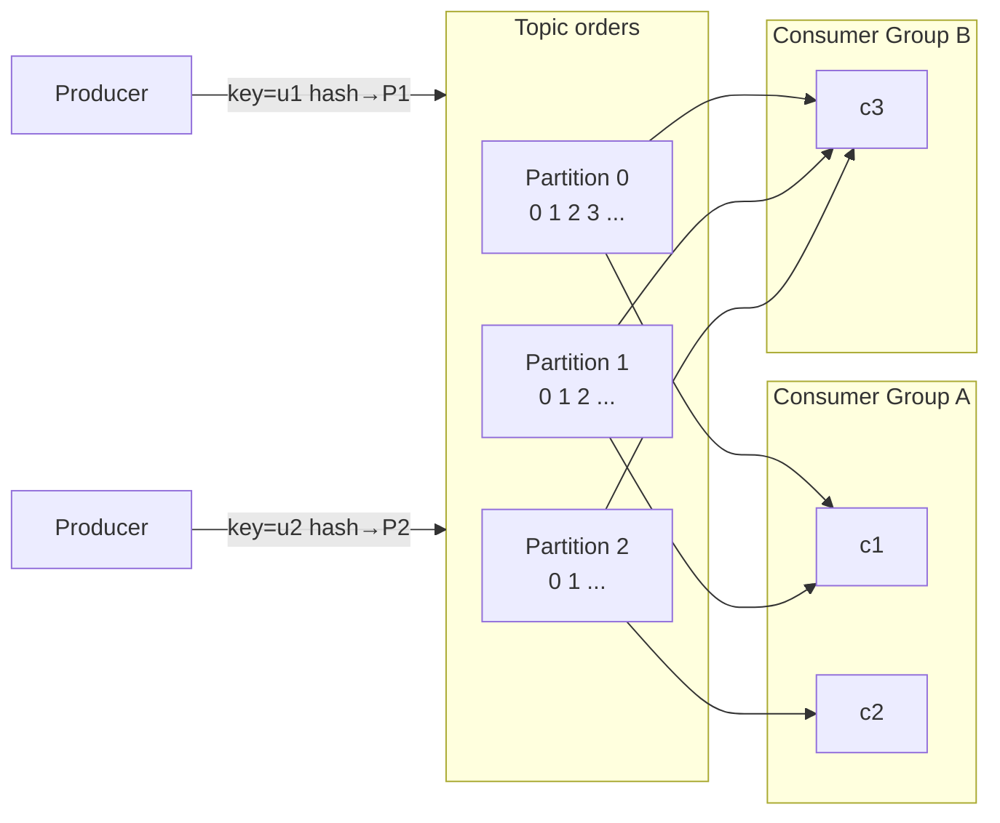

- 分区 = 追加日志，offset 是下标；顺序写 + 页缓存 + `sendfile` 零拷贝 = 高吞吐。
- **同组分摊**（一个分区只能被组内一个消费者消费），**异组广播**。消费者数 > 分区数时多余的空闲。
- 同 key → 同分区 → 分区内有序；全局有序只能单分区。

### 消息可靠性与语义

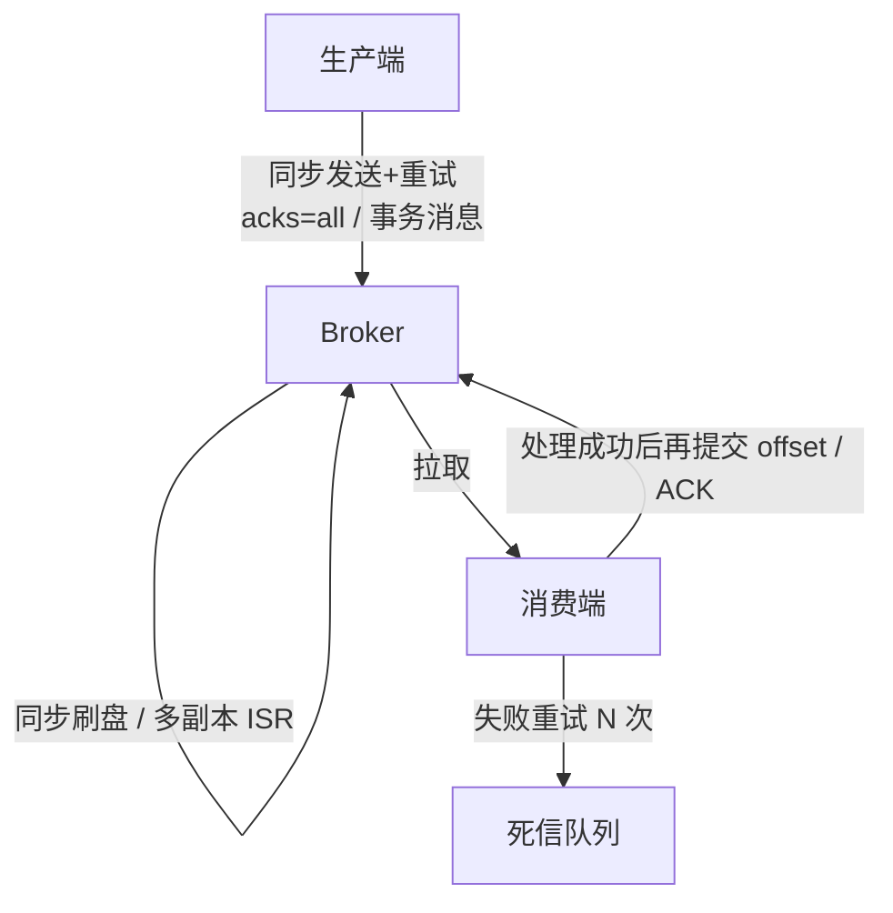

- 三种语义：至多一次（先提交 offset 再处理，可能丢）、**至少一次**（先处理再提交，可能重）、精确一次（Kafka 事务 + 幂等生产者，仅限 Kafka 内部流处理）。
- 示例 `atLeastOnceAndIdempotent` 模拟"处理完未提交 offset 就宕机"→ 重启后 5 条消息全部重复投递，由幂等表拦截。
- 业务幂等手段：唯一业务 ID + 去重表 / Redis SETNX、乐观锁版本号、状态机（只允许 NEW→PAID）。

### 选型对比

| | Kafka | RocketMQ | RabbitMQ |
|--|-------|----------|----------|
| 吞吐 | 百万级 | 十万级 | 万级 |
| 延迟 | ms 级 | ms 级 | 微秒级 |
| 特色 | 流处理、日志、大数据生态 | 事务消息、延迟消息、顺序消息、消息轨迹 | AMQP、灵活路由 Exchange、管理界面友好 |
| 典型场景 | 日志采集、埋点、流计算 | 电商交易链路 | 中小规模业务解耦 |

参考：[apache/kafka](https://github.com/apache/kafka)、[apache/rocketmq](https://github.com/apache/rocketmq)、《Kafka 权威指南》。

---

## 8-5 Elasticsearch

### 倒排索引

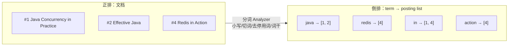

查询 `java action` → 分词 → 查两个 posting list → 合并 → 按相关性评分。复杂度与**命中文档数**相关，而 `LIKE '%java%'` 与总行数相关。

### 相关性评分（BM25 思想）

- TF：词在文档中出现越多越相关（但有饱和，不是线性）。
- IDF：词在越少的文档中出现越有区分度（"in" 几乎每篇都有 → 权重低）。
- 长度归一化：同样出现 1 次，短文档比长文档更相关。

示例 `match("java in action")` 的结果里 *Redis in Action* 排第一（命中两个高 IDF 词），*Java Java Java...* 虽然 TF 高但被长度归一化压制。

### 查询 DSL 要点

- `text` 字段分词，用 `match`；`keyword` 字段不分词，用 `term`。对 text 用 term 查不到是最常见的坑。
- `bool` 查询：`must` / `should` 参与评分；`filter` / `must_not` 不评分且结果缓存为 bitset → 精确条件放 filter。
- 聚合依赖 `doc_values`（列存），text 字段要用 `.keyword` 子字段聚合。
- 深分页 `from + size` 上限 10000，用 `search_after`；导出用 `scroll` / PIT。

### 写入与分片

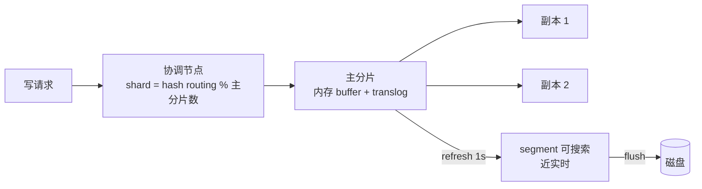

主分片数创建后不可改（路由公式依赖它），副本数可随时调。与 MySQL 同步通常走 canal 监听 binlog → MQ → 写 ES。

参考：[elastic/elasticsearch](https://github.com/elastic/elasticsearch)、[apache/lucene](https://github.com/apache/lucene)、《Elasticsearch 权威指南》。

---

## 8-6 分库分表（ShardingSphere）

### 中间件在做什么


示例 `route()` 用正则实现了这条流水线。没有分片键的 SQL（按 `order_id` 查）会**全路由**到 8 张表再归并，是分库分表后最常见的性能问题。

### 非分片键查询的四种解法

1. **基因法**：生成 `order_id` 时把 `user_id % 表数` 嵌入低位，`order_id` 本身就能算出分片。
2. **映射表**：`order_id → user_id` 的小表（可放 Redis）。
3. **异构索引**：数据同步到 ES，复杂查询走 ES 再回查。
4. **冗余双写**：买家库按 `user_id` 分、卖家库按 `merchant_id` 分。

### 取模 vs 一致性哈希

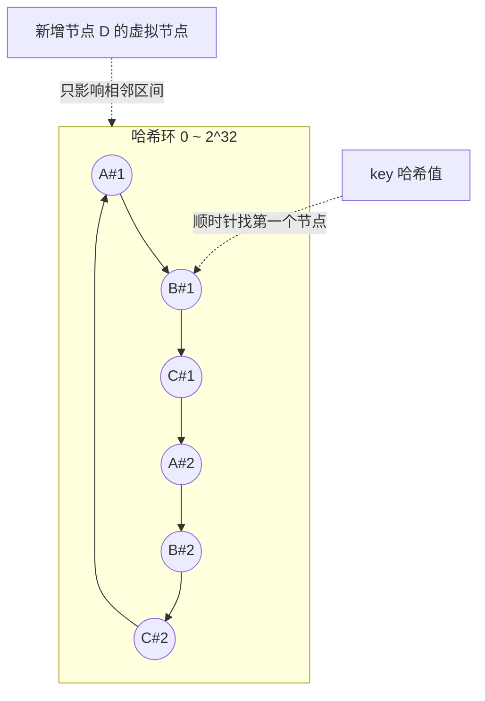

示例实测扩容 3→4 节点：取模迁移 **75%** 数据，一致性哈希（150 虚拟节点）迁移 **约 27%**（理论 25%）。虚拟节点解决节点少时分布不均。

### 雪花算法

```
| 1 bit 符号 | 41 bit 毫秒时间戳 | 5 bit 数据中心 | 5 bit 机器 | 12 bit 序列号 |
```

趋势递增（对 InnoDB 友好）、无中心、单机每毫秒 4096 个。风险是**时钟回拨**（示例直接拒绝生成；生产可等待或用备用位）。其他方案：美团 Leaf 号段模式、百度 UidGenerator。

### 何时分、怎么分

- 先做：索引优化 → 读写分离 → 冷热归档 → 缓存；单表千万级以上且上述都不够再分。
- 先垂直（按业务拆库、冷热列拆表）再水平。
- 分片键：最常用查询维度、分布均匀、不可变。
- 带来的问题：跨分片 JOIN/事务/分页、分布式 ID、扩容迁移（双写 + 全量 + 增量 + 校验 + 切流）。

参考：[apache/shardingsphere](https://github.com/apache/shardingsphere)、[Meituan-Dianping/Leaf](https://github.com/Meituan-Dianping/Leaf)。

---

## 8-7 分布式缓存一致性

### 三种更新策略的不一致场景

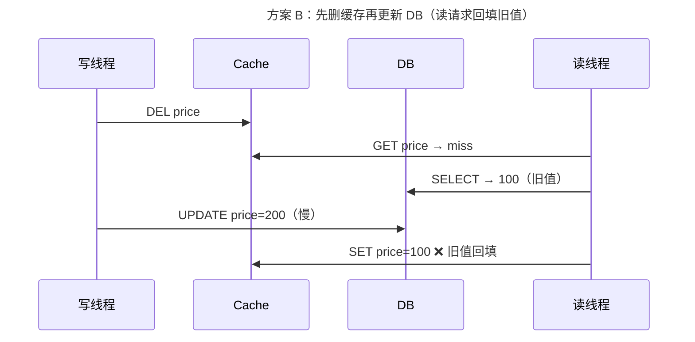

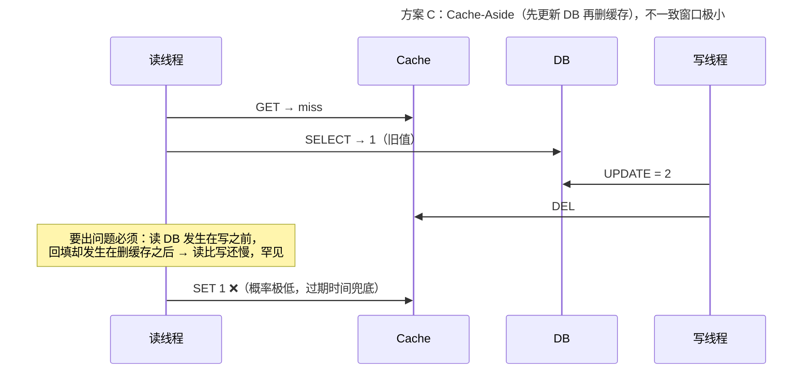

| 策略 | 问题 | 结论 |
|------|------|------|
| A. 更新 DB → 更新缓存 | 并发写覆盖（示例实测 DB=2 Cache=1）；写多读少时浪费 | 不推荐 |
| B. 删缓存 → 更新 DB | 读请求在中间回填旧值（示例复现） | 不推荐，除非延迟双删 |
| C. 更新 DB → 删缓存 | 理论窗口需要"读比写慢"，极罕见 | **默认选择** |
| 延迟双删 | 删 → 更新 DB → 睡 N ms → 再删 | N 难定，写延迟增加 |

删缓存失败的补偿：重试队列，或订阅 binlog（canal）异步删除，与业务代码解耦。

### 缓存击穿：互斥重建

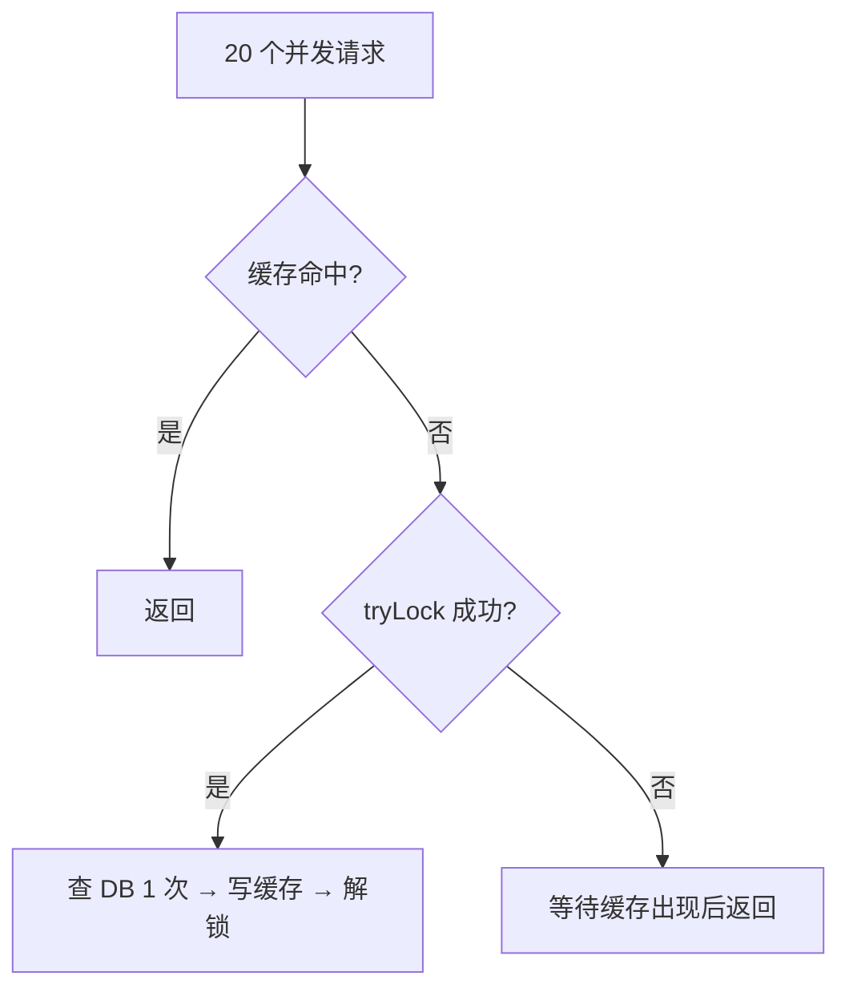

示例 20 个并发请求 DB 只被读了 1 次。另一方案是**逻辑过期**：缓存永不过期，值中带过期时间，发现过期后异步刷新并先返回旧值。

### 缓存穿透：布隆过滤器

- k 个哈希函数把 key 映射到位数组的 k 个位置；查询时任一位为 0 → 一定不存在；全为 1 → 可能存在。
- 示例 1 万元素 / 10 万 bit（约 12KB）/ 4 个哈希，误判率约 1%。
- 不支持删除（Counting Bloom / Cuckoo Filter 可以）；Redis 有 RedisBloom 模块，Guava 有 `BloomFilter`。

### 多级缓存

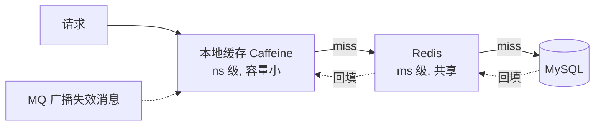

本地缓存多实例不一致 → 用 MQ 广播失效或设置很短的过期时间。热点 key 加随机后缀打散；大 key 拆分、`UNLINK` 异步删除。

参考：[ben-manes/caffeine](https://github.com/ben-manes/caffeine)、[alibaba/jetcache](https://github.com/alibaba/jetcache)、[alibaba/canal](https://github.com/alibaba/canal)、《凤凰架构》。
