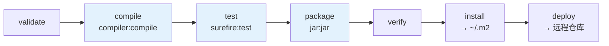
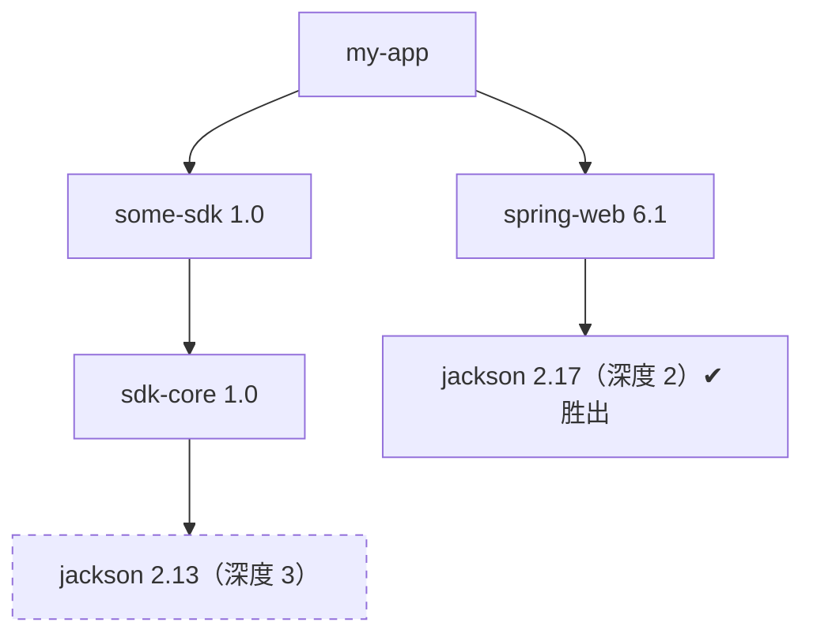
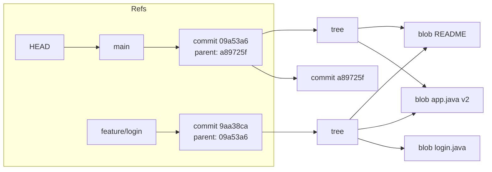
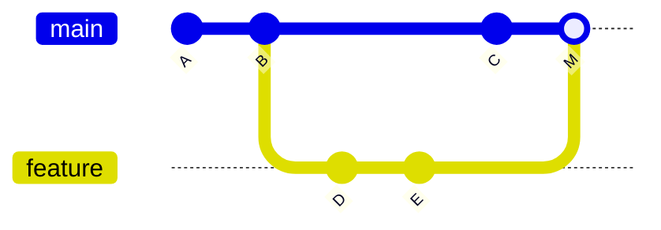
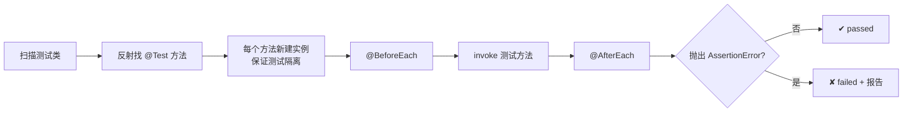
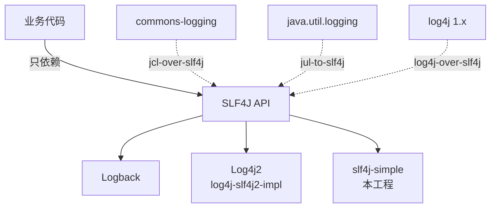
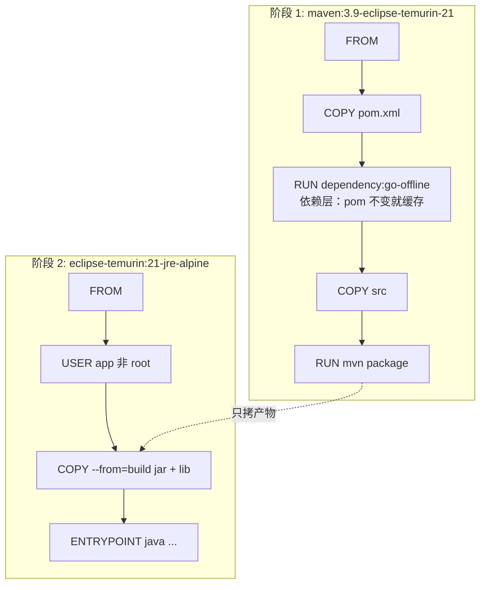
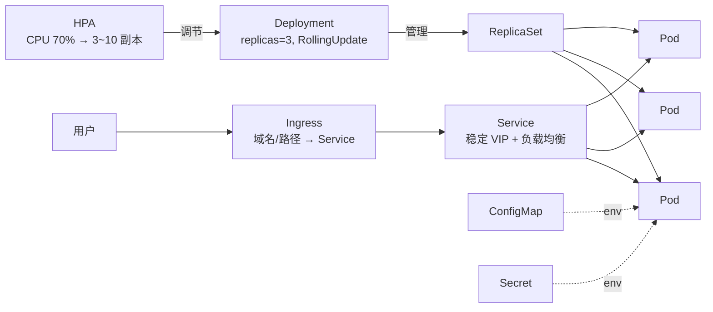
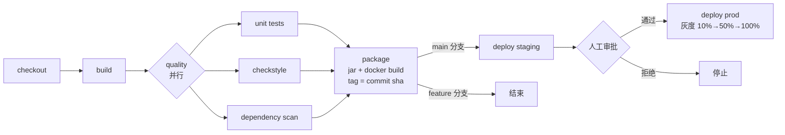
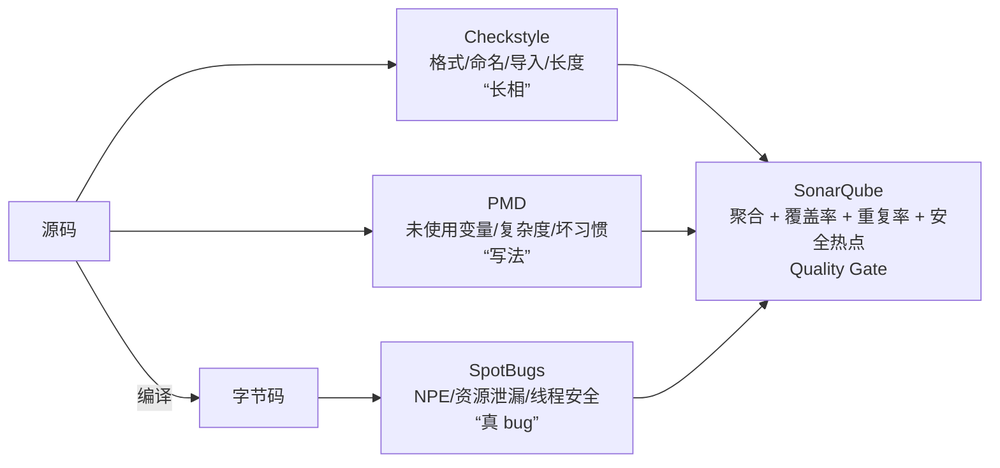

# 09 · 工程化与工具

> 把代码变成可持续交付的软件。本章除了可运行示例，还附带**可直接拿去用的配置样例**：
> `Dockerfile`、`deploy/k8s.yaml`、`ci/github-actions.yml`、`ci/Jenkinsfile`、`config/checkstyle-sample.xml`、
> `docs/samples/logback-spring.xml`、`.editorconfig`。示例代码位于 `src/main/java/com/javalearning/engineering/`，
> 真实的 JUnit 5 + Mockito 测试在 `src/test/java/...`（`mvn test`）。

| # | 知识点 | 示例代码 | 演示内容 | 配置样例 |
|---|--------|----------|----------|----------|
| 9-1 | Maven / Gradle | `BuildToolsDemo` | 解析本工程 pom、生命周期、依赖仲裁模拟、Gradle 对照 | `pom.xml` |
| 9-2 | Git 协作与分支策略 | `GitWorkflowDemo` | 手写 MiniGit：内容寻址、分支、fast-forward、三方合并、冲突 | — |
| 9-3 | JUnit 5 / Mockito | `UnitTestDemo` + `OrderServiceTest` | MiniJUnit / MiniMock 原理 + 真实测试（参数化、嵌套、Captor） | `src/test` |
| 9-4 | 日志 | `LoggingDemo` | SLF4J 占位符、异常堆栈、MDC、性能对比 | `simplelogger.properties`、`logback-spring.xml` |
| 9-5 | Docker / K8s | `DockerK8sDemo` | 解读 Dockerfile、层缓存模拟、K8s 对象、JVM 容器感知 | `Dockerfile`、`deploy/k8s.yaml` |
| 9-6 | CI / CD | `CicdDemo` | 迷你流水线引擎：阶段/并行/fail-fast/分支条件/审批 | `ci/github-actions.yml`、`ci/Jenkinsfile` |
| 9-7 | 代码规范与静态检查 | `CodeStyleDemo` | 迷你 Checkstyle 扫描本工程、典型 bug 模式 | `config/checkstyle-sample.xml`、`.editorconfig` |

---

## 9-1 Maven / Gradle 构建与依赖管理

### 生命周期与插件



- 执行某阶段会先跑完它前面所有阶段；`mvn clean package -DskipTests` 跨两个生命周期。
- 阶段只是"钩子"，真正干活的是绑定在阶段上的**插件目标**（`plugin:goal`）。本工程 `exec:java` 直接调用目标。

### 依赖 scope

| scope | 编译 | 测试 | 运行 | 典型 |
|-------|------|------|------|------|
| compile | ✔ | ✔ | ✔ | 业务依赖 |
| provided | ✔ | ✔ | ✘ | servlet-api、lombok |
| runtime | ✘ | ✔ | ✔ | JDBC 驱动、日志实现 |
| test | ✘ | ✔ | ✘ | junit、mockito |
| import | — | — | — | 仅 `dependencyManagement` 导入 BOM |

### 依赖冲突仲裁



- Maven：**最短路径优先**，路径相同**先声明优先**。示例 `dependencyMediation` 手写了这个算法并输出类似 `dependency:tree -Dverbose` 的 "omitted for conflict" 标记。
- Gradle：默认**最高版本优先**。
- 治理：`<dependencyManagement>` 锁版本（Spring Boot BOM 就是这个）、`<exclusions>`、`mvn dependency:tree`、`mvn help:effective-pom`。

### Maven vs Gradle

| | Maven | Gradle |
|--|-------|--------|
| 配置 | XML 声明式 | Groovy / Kotlin DSL |
| 速度 | 一般 | 增量构建 + 构建缓存 + 守护进程，大项目快很多 |
| 依赖配置 | scope | `implementation`（不传递编译类路径）/ `api` / `runtimeOnly` / `testImplementation` |
| 生态 | 传统 Java 后端主流 | Android 官方、Spring 自身、Kotlin 项目 |

参考：[apache/maven](https://github.com/apache/maven)、[gradle/gradle](https://github.com/gradle/gradle)、《Maven 实战》。

---

## 9-2 Git 协作与分支策略

### 对象模型：一切皆内容寻址



- blob（文件内容）/ tree（目录）/ commit（快照 + 父指针 + 信息）全部以 SHA-1 命名并存在 `.git/objects`。
- **分支只是一个指向 commit 的文件**（`.git/refs/heads/main` 里一行 SHA），所以建分支、切分支几乎零成本。
- 内容相同的文件只存一份：示例两个提交共享同一个 README blob。
- 历史被篡改 → 后续所有 SHA 都变 → 这就是完整性保证，也是 rebase 会"改写历史"的原因。

### 合并的两种形态



- **fast-forward**：当前分支没有新提交 → 直接移动指针，不产生合并提交（`--no-ff` 可强制产生）。
- **三方合并**：找公共祖先 base，对每个文件比较 base / ours / theirs：只有一方改 → 取改动方；双方改且不同 → **冲突**。示例 `merge()` 实现了这个决策表。
- **rebase**：把分支提交逐个重放到目标分支顶端，历史线性但提交 id 全变。黄金法则：**不要 rebase 已推送且他人基于其工作的分支**。

### 分支策略选型

| 策略 | 分支 | 适合 |
|------|------|------|
| Git Flow | master / develop / feature / release / hotfix | 有明确版本周期的产品（客户端、SDK） |
| GitHub Flow | main + 短 feature 分支 + PR | 持续交付的 Web 服务 |
| GitLab Flow | GitHub Flow + 环境分支 | 多环境、需要受控发布 |
| Trunk-Based | 直接提交 trunk / 极短分支 + Feature Toggle | 高频部署、测试完备的团队 |

提交信息遵循 [Conventional Commits](https://www.conventionalcommits.org/zh-hans/)：`feat: ` / `fix: ` / `docs: ` / `refactor: ` …，便于自动生成 CHANGELOG 与语义化版本。

### 救急命令

`git reflog`（找回任何被"丢掉"的提交）、`git stash`、`git cherry-pick`、`git bisect`（二分定位引入 bug 的提交）、`git revert`（公共分支回滚用它而不是 reset）。

参考：[Pro Git 中文版](https://git-scm.com/book/zh/v2)、[trunkbaseddevelopment.com](https://trunkbaseddevelopment.com/)。

---

## 9-3 单元测试：JUnit 5 / Mockito

### 测试框架在做什么



示例 `UnitTestDemo.runTests()` 用 30 行实现了这个循环；`MiniMock` 用 JDK 动态代理实现了"记录调用 + 按参数打桩 + 验证"——这就是 Mockito 的核心（真实 Mockito 用 ByteBuddy 生成子类，所以能 mock 类而不只是接口）。

### 真实测试要点（`OrderServiceTest`）

```java
@ExtendWith(MockitoExtension.class)
class OrderServiceTest {
    @Mock ProductRepository repo;
    @Mock PaymentGateway payment;
    @InjectMocks OrderService service;          // 构造器注入两个 mock

    @ParameterizedTest(name = "购买 {0} 件应付 {1}")
    @CsvSource({"1, 10.00", "10, 90.000"})     // 数据驱动
    void placeOrder_discountRule(int qty, BigDecimal expected) { ... }

    @Test
    void placeOrder_success_savesReducedStock() {
        when(payment.charge(eq("u1"), any())).thenReturn(true);
        service.placeOrder("u1", "A1", 3);
        ArgumentCaptor<Product> saved = ArgumentCaptor.forClass(Product.class);
        verify(repo).save(saved.capture());        // 捕获参数再断言副作用
        assertEquals(97, saved.getValue().stock());
    }
}
```

- `MockitoExtension` 默认 **STRICT_STUBS**：没用到的 `when(...)` 会报 `UnnecessaryStubbingException`，逼你把打桩放在真正需要的测试里（这也是测试写得清晰的信号）。
- `@Nested` 按场景分组（正常路径 / 异常路径），`@DisplayName` 让报告可读。
- `verify(x, never())` 验证"不该发生的事"同样重要（没查到商品不能扣款）。

### 原则

- **F.I.R.S.T**：Fast、Independent、Repeatable、Self-validating、Timely。
- 一个测试一个行为；命名 `方法_场景_期望`；Arrange / Act / Assert 三段。
- 只 mock 外部依赖（DB、HTTP、时钟、随机数）；mock 太多说明设计耦合。
- 测试金字塔：大量单测 → 适量集成测试（[Testcontainers](https://github.com/testcontainers/testcontainers-java) 起真实 MySQL/Redis）→ 少量端到端。
- 覆盖率（JaCoCo）是下限不是目标；变异测试（PIT）检验测试是否真能发现 bug。

参考：[junit-team/junit5](https://github.com/junit-team/junit5)、[mockito/mockito](https://github.com/mockito/mockito)、[assertj/assertj](https://github.com/assertj/assertj)。

---

## 9-4 日志：SLF4J / Logback / Log4j2

### 门面与实现



代码只依赖门面，换实现只改依赖；第三方库用的其他日志框架通过桥接包统一收编。类路径出现多个实现会有 "multiple SLF4J providers" 警告，需排除。

### 正确写法

| 写法 | 问题 |
|------|------|
| `log.debug("x=" + obj)` | 级别关闭仍执行拼接与 `toString`；示例实测 10 万次 66ms vs 0.8ms |
| `log.error("失败: " + e.getMessage())` | 丢掉堆栈 |
| `log.error("失败 input={}", input, e)` | ✔ 异常放最后一个参数 |
| `MDC.put("traceId", id)` 忘记 `MDC.clear()` | 线程池复用导致串 traceId |

### Logback 配置结构（见 `docs/samples/logback-spring.xml`）

```mermaid
flowchart LR
    L[Logger 层级<br/>com.example.service → com.example → root] --> A1[ConsoleAppender]
    L --> AS[AsyncAppender<br/>队列 + 独立线程]
    AS --> RF[RollingFileAppender<br/>SizeAndTimeBased 按天+按大小]
    L --> EF[ERROR 单独文件<br/>ThresholdFilter]
    RF --> E[Encoder / Pattern<br/>%d %-5level %X{traceId} %logger - %msg]
```

- `additivity="false"` 阻止向父 Logger 传播，避免重复输出。
- `<springProfile name="prod">` 按环境切换；JSON 输出用 logstash-logback-encoder 便于 ELK / Loki 采集。
- Log4j2 的全异步（Disruptor）吞吐更高；2021 年 Log4Shell 提醒：及时升级。

参考：[qos-ch/logback](https://github.com/qos-ch/logback)、[apache/logging-log4j2](https://github.com/apache/logging-log4j2)、[alibaba/transmittable-thread-local](https://github.com/alibaba/transmittable-thread-local)（跨线程池传 MDC）。

---

## 9-5 Docker / Kubernetes 部署

### 多阶段构建与层缓存（见 `Dockerfile`）



示例 `layerCache()` 用哈希链模拟：**只改源码**时前三层 CACHED；**改 pom** 时从 COPY pom 开始全部重建。所以"先 COPY pom 下载依赖，再 COPY src"是 Java 镜像的标准写法。

镜像瘦身：JRE 而非 JDK、alpine / distroless、`jlink` 裁剪、Spring Boot 分层 jar。

### K8s 资源对象（见 `deploy/k8s.yaml`）



### 三个探针与零停机发布

| 探针 | 失败后果 | 用途 |
|------|----------|------|
| startupProbe | 重启（但给足启动时间） | JVM 启动慢，避免 liveness 过早杀 |
| livenessProbe | **重启容器** | 死锁、假死 |
| readinessProbe | **摘流不重启** | 依赖暂不可用、预热中 |

零停机 = `maxUnavailable: 0` + readiness 通过才接流 + `preStop sleep` 等 Endpoint 摘除传播 + 优雅停机（`server.shutdown=graceful`）+ `terminationGracePeriodSeconds`。

### JVM 在容器里

- JDK 10+ 默认容器感知：`availableProcessors` 与默认堆按 cgroup limit 计算。
- `limits.memory` 决定堆上限（`-XX:MaxRAMPercentage=75`），超过 → `OOMKilled`（exit 137）；要给堆外（Metaspace、线程栈、直接内存）留空间。
- `limits.cpu: 500m` 时 `availableProcessors` = 1，线程池与 GC 线程数据此调整。

参考：[GoogleContainerTools/distroless](https://github.com/GoogleContainerTools/distroless)、《Kubernetes in Action》、[kubernetes.io 中文文档](https://kubernetes.io/zh-cn/docs/)。

---

## 9-6 CI / CD 流水线

### 流水线形态



示例 `CicdDemo` 的迷你引擎实现了：阶段顺序 / 阶段内 `CompletableFuture` 并行 / 任一 Job 失败即停 / `onlyOn("main")` 分支条件 / 审批 Job 返回 false 阻断。三个场景分别演示 PR 流水线、测试失败被门禁拦截、全通过发布。

### 关键原则

- **一次构建、多处部署**：镜像在 CI 构建一次，用不可变 tag（commit sha）推到各环境；禁止每个环境各自构建。
- **快**：CI 10 分钟内；缓存依赖（`actions/setup-java cache: maven`）与 Docker 层；并行无依赖的 Job。
- **质量门禁**：单测 + 覆盖率阈值（JaCoCo）+ 静态检查 + 依赖漏洞扫描（Trivy / OWASP Dependency-Check）+ SonarQube Quality Gate。
- **流水线即代码**：`.github/workflows/*.yml`、`Jenkinsfile` 进 Git 走 Code Review。
- **数据库变更向前兼容**：先加列再删列，Flyway / Liquibase 管理迁移脚本，保证可回滚。

### 发布策略

| 策略 | 做法 | 代价 |
|------|------|------|
| 滚动更新 | K8s 默认，逐个替换 Pod | 新旧版本短暂共存 |
| 蓝绿 | 两套环境切流量 | 资源翻倍，回滚最快 |
| 金丝雀 / 灰度 | 按比例或用户标签逐步放量 | 需要可观测性支撑 |
| 功能开关 | 代码上线但不可见 | 开关债务要清理 |

### 两份样例

- `ci/github-actions.yml`：`build-test` 与 `static-analysis` 并行 → `docker-image`（仅 main，推 GHCR，GHA 缓存）→ `deploy-staging`（environment 保护规则）。
- `ci/Jenkinsfile`：声明式流水线，`parallel` 质量阶段、`when { branch 'main' }`、`input` 人工审批、`post { failure }` 通知。

参考：[actions/starter-workflows](https://github.com/actions/starter-workflows)、[argoproj/argo-cd](https://github.com/argoproj/argo-cd)、《持续交付》。

---

## 9-7 代码规范与静态检查

### 工具分工



示例 `CodeStyleDemo.lintProject()` 用正则实现了 7 条规则并扫描本工程自身——它真的找出了几处超长行和未使用导入；真实 Checkstyle 基于 AST，能区分字符串/注释里的内容，规则 100+。

### 静态分析能抓到的典型问题（`SmellyCode`）

| 代码 | 工具告警 | 后果 |
|------|----------|------|
| `a == b` 比较字符串 | SpotBugs ES_COMPARING_STRINGS_WITH_EQ | 内容相同也可能 false |
| `Integer a == Integer b` | Sonar S4973 | 缓存只到 127，128 起为 false |
| `catch (E e) { return 0; }` | PMD EmptyCatchBlock | 静默失败，0 与真实 0 无法区分 |
| 循环里 `s += x` | PMD UseStringBufferForStringAppends | O(n²) |
| 流未关闭 | SpotBugs OBL_UNSATISFIED_OBLIGATION | 文件句柄泄漏 |
| `int / Integer` | SpotBugs NP / Sonar | 拆箱 NPE、除零 |

### 规范落地

1. 选一套规范：[阿里巴巴 Java 开发手册](https://github.com/alibaba/p3c)（+ IDEA 插件）或 [Google Java Style](https://google.github.io/styleguide/javaguide.html)。
2. `.editorconfig` 统一编辑器基础设置（已附）；格式化交给工具（google-java-format / Spotless），不在 Review 里争论格式。
3. 本地 pre-commit hook 做格式化 + 快速检查，CI 用 `maven-checkstyle-plugin`（`failOnViolation`）兜底。
4. 覆盖率门禁 `jacoco:check`、SonarQube Quality Gate 不过不能合并。
5. Code Review：小 PR（< 400 行）、说明动机与影响面、评论区分 nit / 建议 / 必须改；正确性 > 可读性 > 性能。

参考：[checkstyle/checkstyle](https://github.com/checkstyle/checkstyle)、[pmd/pmd](https://github.com/pmd/pmd)、[spotbugs/spotbugs](https://github.com/spotbugs/spotbugs)、[diffplug/spotless](https://github.com/diffplug/spotless)。
