# 10 · 设计模式与架构

> 从"写得对"到"写得好"再到"系统能扛"。本章前四节是代码级设计（GoF 模式、SOLID），后四节是系统级设计
> （DDD、分布式、高并发防护、系统设计方法论）。所有示例都用纯 Java 模拟多节点/多服务，可离线运行。
> 示例位于 `src/main/java/com/javalearning/patterns/`。

| # | 知识点 | 示例代码 | 演示内容 | 难度 |
|---|--------|----------|----------|------|
| 10-1 | 创建型：单例 / 工厂 / 建造者 | `CreationalPatternsDemo` | DCL 并发验证、反射与反序列化破坏单例、枚举单例、注册表工厂、Builder 校验、原型深浅拷贝 | ★★ |
| 10-2 | 结构型：代理 / 适配器 / 装饰器 | `StructuralPatternsDemo` | 静态→动态代理叠加、适配器、装饰器链、外观、组合、享元，三者意图对比 | ★★ |
| 10-3 | 行为型：策略 / 观察者 / 模板方法 / 责任链 | `BehavioralPatternsDemo` | Map 策略表、事件总线异常隔离、钩子方法、Chain 递推、枚举状态机、可撤销命令 | ★★ |
| 10-4 | SOLID 原则 | `SolidDemo` | 每条原则"违反 vs 遵守"对照并运行出后果（正方形/矩形、胖接口、依赖具体类） | ★★ |
| 10-5 | 微服务与 DDD | `DddDemo` | 贫血 vs 充血模型、聚合根守护不变量、值对象、领域事件、仓储、防腐层、限界上下文 | ★★★★ |
| 10-6 | 分布式：锁 / 事务 / CAP | `DistributedDemo` | 带 fencing token 的锁、2PC、TCC、Saga 补偿、网络分区下 CP vs AP | ★★★★ |
| 10-7 | 高并发：限流 / 熔断 / 降级 | `ResilienceDemo` | 四种限流器突刺对比、三态熔断器、舱壁隔离、指数退避重试 | ★★★ |
| 10-8 | 系统设计与性能优化 | `SystemDesignDemo` | 短链服务：容量估算、Base62、Zipf 流量下的缓存命中率、并行 fan-out、利特尔法则 | ★★★★ |

---

## 10-1 创建型模式

### 单例的几种写法

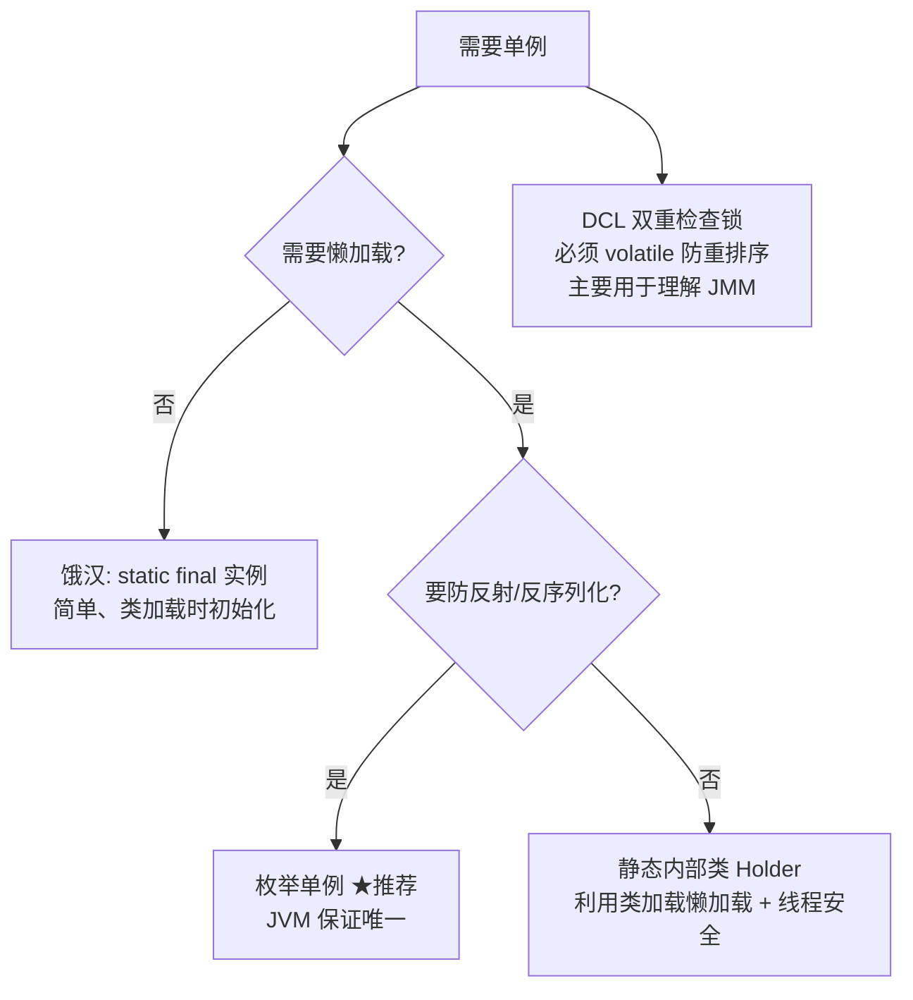

示例实测：64 线程并发 DCL 只产生 1 个实例；普通单例被反射 `newInstance()` 和反序列化各造出一个新实例；枚举反射创建直接抛 `Cannot reflectively create enum objects`。

DCL 为什么要 `volatile`：`instance = new X()` 不是原子操作，可能重排为 "分配内存 → 赋值引用 → 初始化"，另一个线程在第一次检查看到非 null 却拿到未初始化对象。

### 工厂的三个层次

| 模式 | 结构 | 新增产品时 | JDK 例子 |
|------|------|-----------|----------|
| 简单工厂 | 一个静态方法 + switch | 改工厂方法 | `Calendar.getInstance()` |
| 工厂方法 | 抽象创建方法 / 注册表 | 加一个实现或注册一行 | `Collection.iterator()`、SPI |
| 抽象工厂 | 创建一族相关产品 | 加一个工厂类 | `DocumentBuilderFactory` |

### 建造者

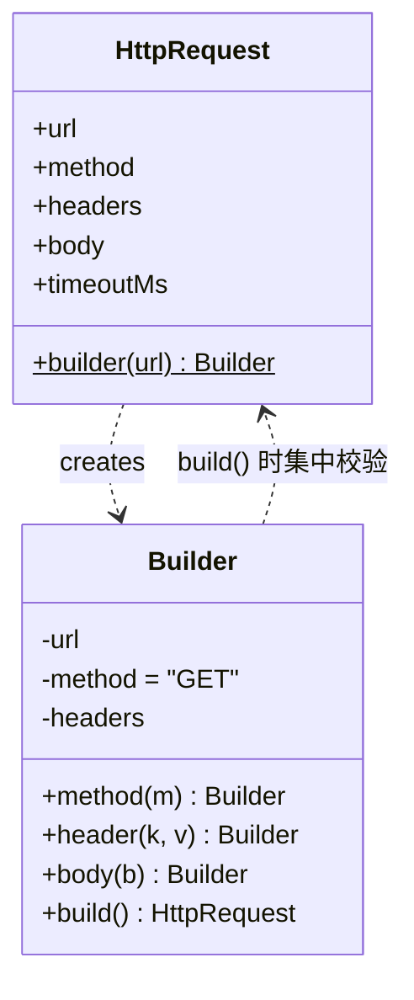

解决伸缩构造器反模式、可选参数、不可变对象、构建时校验（示例中 GET 带 body 在 `build()` 被拒绝）。实际项目用 Lombok `@Builder`。

---

## 10-2 结构型模式

### 代理 / 装饰器 / 适配器：结构相同，意图不同

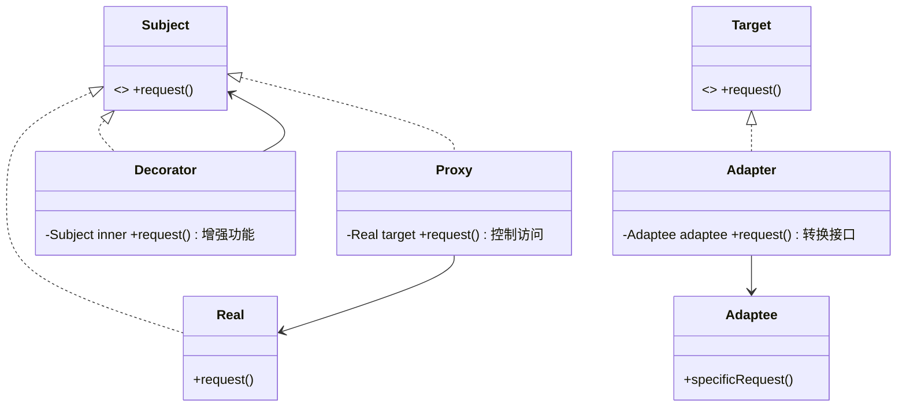

| | 代理 | 装饰器 | 适配器 |
|--|------|--------|--------|
| 接口 | 与目标相同 | 与目标相同 | **不同**（这是本质区别） |
| 谁来包装 | 框架 / 创建处，调用方无感 | 调用方显式层层包装 | 集成处 |
| 意图 | 控制访问：权限、懒加载、事务、远程 | 动态加职责，可任意组合 | 让不兼容的接口协作 |
| 典型 | Spring AOP、MyBatis Mapper、RPC 桩 | `java.io` 流、`Collections.unmodifiableList` | `InputStreamReader`、`Arrays.asList`、`HandlerAdapter` |

示例把**权限代理**叠在**计时代理**之上，guest 调 `delete` 被拦截；装饰器 `Encrypt(Compress(Memory))` 写入时加密再压缩，读取时逆序还原。

### 动态代理原理

`Proxy.newProxyInstance(loader, interfaces, handler)` 运行时生成 `$ProxyN` 字节码，所有方法调用转发到 `InvocationHandler.invoke(proxy, method, args)`。JDK 代理要求有接口；CGLIB / ByteBuddy 生成子类可代理普通类。

---

## 10-3 行为型模式

### 策略：消灭 if-else

```java
Map<String, DiscountStrategy> STRATEGIES = Map.of(
    "VIP",       p -> p.multiply(new BigDecimal("0.8")),
    "COUPON_10", p -> p.subtract(BigDecimal.TEN).max(BigDecimal.ZERO));
STRATEGIES.get(type).apply(price);
```

Spring 中各策略标 `@Component`，注入 `Map<String, DiscountStrategy>` 自动按 bean 名收集。

### 责任链：Chain 递推

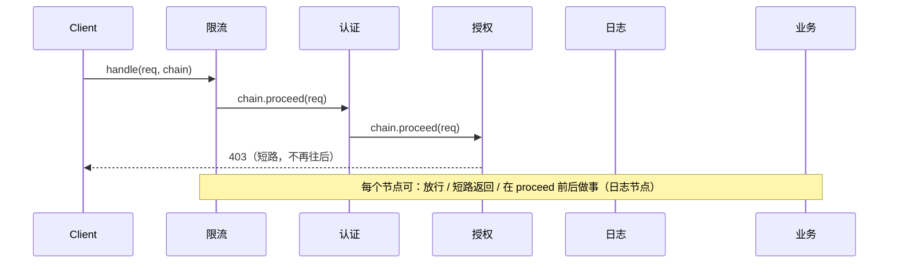

`Chain` 用 `index + 1` 构造下一个链对象，与 Servlet `FilterChain`、OkHttp `Interceptor.Chain` 完全一致。

### 状态：枚举状态机

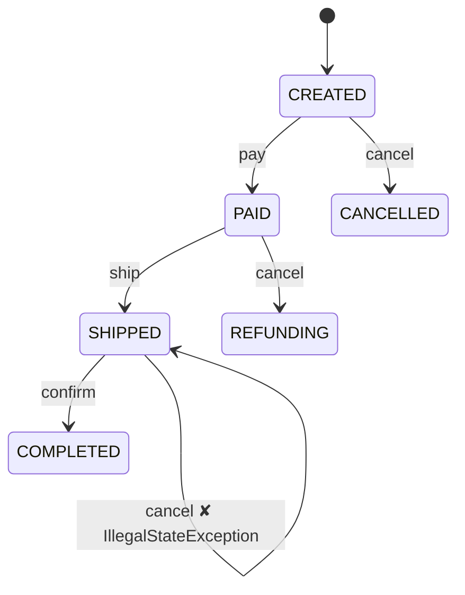

每个枚举常量只覆盖自己允许的事件方法，其余走默认实现抛异常——转换规则内聚在状态里，而不是散落在各处 `if (status == X && event == Y)`。

### 其他

- **观察者**：示例 `EventBus` 对每个监听器 try/catch，一个失败不影响其他；Spring `@EventListener` / `@TransactionalEventListener`；跨进程就是 MQ。
- **模板方法**：`final run()` 固定骨架 + 抽象步骤 + 钩子方法；函数式替代是把步骤作为 lambda 传入（`TransactionTemplate.execute(callback)`）。
- **命令**：封装请求 → 可排队 / 撤销 / 重放；`Runnable` 是最简命令，线程池是调用者。

---

## 10-4 SOLID 原则

| 原则 | 一句话 | 示例中的"违反" | 运行后果 |
|------|--------|----------------|----------|
| **S** 单一职责 | 一个类只有一个变化原因 | `ReportGod` 同时计算、渲染、持久化 | 任何需求变化都要改它 |
| **O** 开闭 | 加功能靠新增不靠修改 | `areaSwitch` 用 instanceof 分支 | 加三角形必须改方法 |
| **L** 里氏替换 | 子类不能破坏父类契约 | `Square extends Rectangle` | 设宽 5 高 4 面积得 16 |
| **I** 接口隔离 | 不强迫实现用不到的方法 | `CheapPrinter implements AllInOneMachine` | `fax()` 运行时抛 Unsupported |
| **D** 依赖倒置 | 依赖抽象，构造器注入 | `new MysqlOrderDao()` 写死 | 无法替换、无法单测 |

### LSP 的判断标准

子类不能：加强前置条件、削弱后置条件、抛父类未声明的异常、让父类方法失效。JDK 反例：`Stack extends Vector`、`Properties extends Hashtable`。

### DIP 与架构

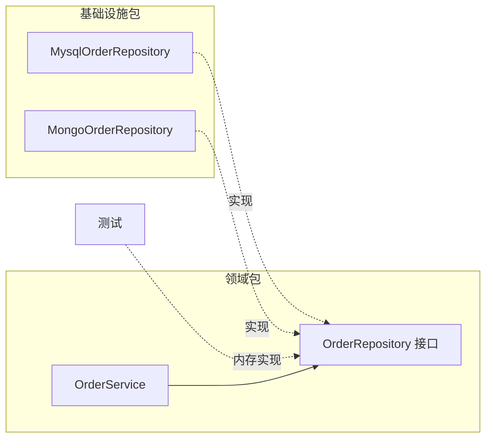

接口归高层（领域）所有，实现在低层——依赖方向"倒置"。这正是六边形 / 整洁架构的依赖规则，Spring IoC 是落地手段。

---

## 10-5 微服务与领域驱动设计（DDD）

### 贫血 vs 充血

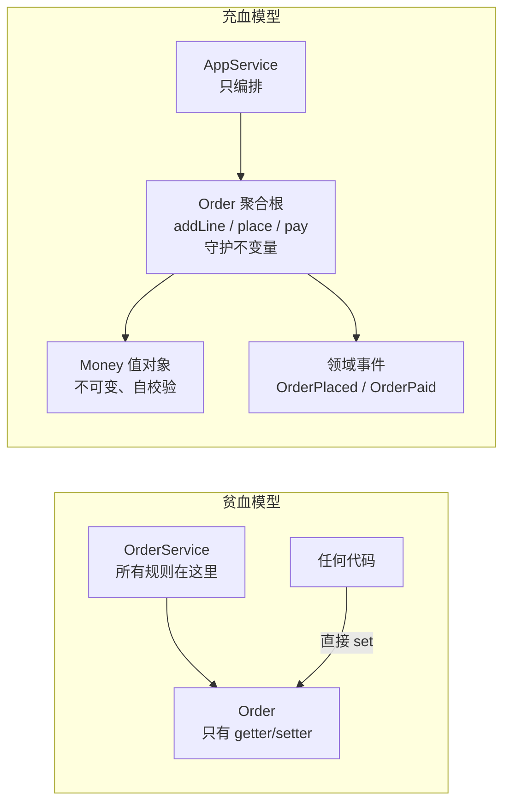

示例贫血版可以被任意改成 `status=PAID total=-999 lines=0`；充血版对"已支付后加商品 / 金额不符 / 负金额 / 空订单提交"四种破坏全部拒绝，且规则只写在聚合根一处。

### 战术模式速查

| 概念 | 要点 | 示例 |
|------|------|------|
| 值对象 | 无标识、不可变、按值相等、自带校验 | `record Money`（record 天生合适） |
| 实体 | 有标识、可变、生命周期由聚合管理 | `OrderLine`（私有构造，外部拿不到） |
| 聚合根 | 一致性边界的唯一入口；一个事务只改一个聚合 | `Order` |
| 领域事件 | 过去式命名，解耦聚合与上下文 | `OrderPaid` → 发 MQ（Outbox 保证不丢） |
| 仓储 | 接口在领域层，以聚合为单位存取 | `OrderRepository` |
| 应用服务 | 编排用例、事务边界，不含业务规则 | `PlaceOrderAppService` |
| 防腐层 | 翻译外部模型，隔离外部变化 | `PaymentGatewayAcl` |

### 分层与依赖方向

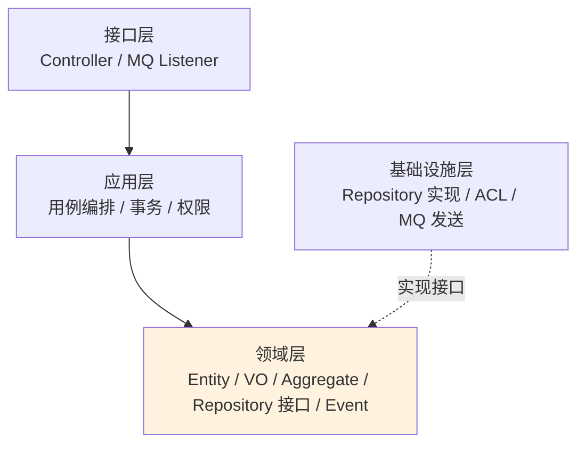

依赖只能向内，领域层不依赖任何框架。

### 战略设计：限界上下文 → 微服务

同一个词在不同上下文含义不同（"商品"在商品 / 订单 / 库存上下文各是一套模型），强行共用一张大表就是"大泥球"。拆分启发：事件风暴找领域事件 → 命令 → 聚合 → 按内聚的聚合簇划上下文。微服务是限界上下文的部署形态，可先做模块化单体，边界稳定后再独立部署；每个服务独享数据库。

参考：[alibaba/COLA](https://github.com/alibaba/COLA)、[citerus/dddsample-core](https://github.com/citerus/dddsample-core)、《实现领域驱动设计》。

---

## 10-6 分布式：锁 / 事务 / 一致性（CAP）

### 分布式锁与 fencing token

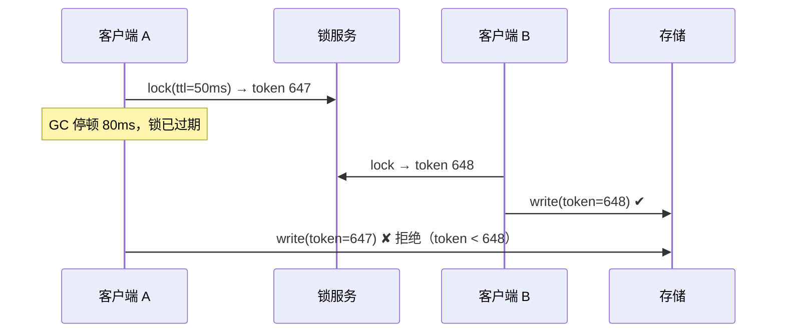

锁一定要有过期时间（防死锁），但过期就可能"双持有"。存储层校验单调递增的 fencing token 是唯一彻底的解法（ZooKeeper zxid / etcd revision 天然提供）。

| 实现 | 一致性 | 特点 |
|------|--------|------|
| Redis `SET NX PX` | AP | 快；主从切换可能双持锁；Redisson 看门狗续期 |
| ZooKeeper 临时顺序节点 | CP | 会话断开自动释放；watch 前驱避免惊群 |
| etcd lease + revision | CP | 自带 fencing |

### 分布式事务对比

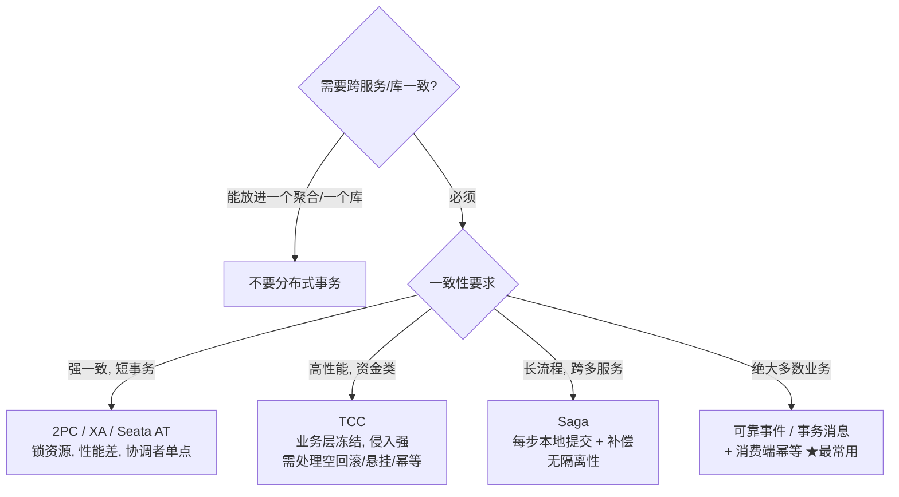

示例运行：2PC 中账户库 prepare 失败 → 订单库 rollback；TCC 余额 try 失败 → 逆序 cancel 库存与积分；Saga 扣款失败 → 逆序补偿后库存与积分回到初始值。

### CAP

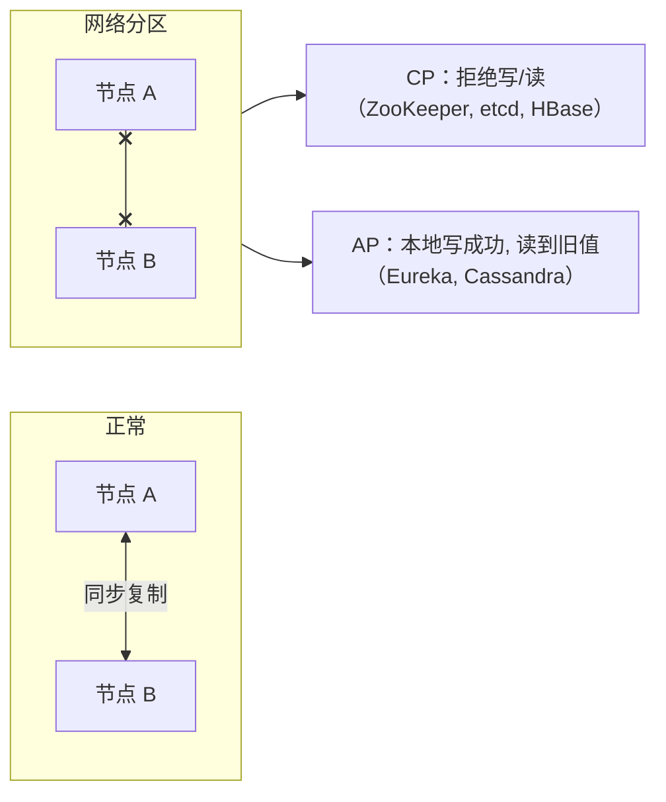

P 不是选项（网络一定会分区），实际是分区时选 C 还是 A；BASE 是 AP 的务实表述。Paxos / Raft（多数派 + 日志复制）是 CP 系统的基石。

参考：DDIA 第 5/7/8/9 章、[seata/seata](https://github.com/seata/seata)、Martin Kleppmann《How to do distributed locking》。

---

## 10-7 高并发：限流 / 熔断 / 降级

### 四种限流算法

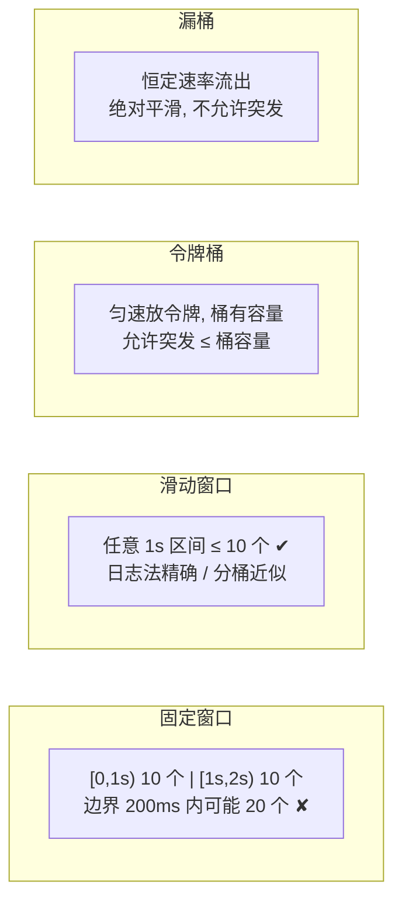

示例在 900~1090ms 之间打 20 个请求（横跨窗口边界）：固定窗口放行 **20**，滑动窗口 **10**，令牌桶 / 漏桶 **11**。

### 熔断器状态机

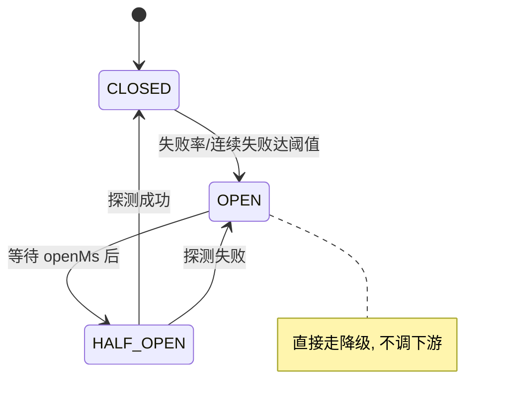

示例 8 个请求中下游只被真正调用 3 次（阈值）+ 1 次探测；其余由熔断器快速返回降级结果。生产实现（Resilience4j / Sentinel）按滑动窗口的**失败率 / 慢调用比例**触发。

### 防护体系（从外到内）

CDN → 网关限流 → 服务限流 → **隔离**（线程池 / 信号量舱壁，示例 10 个请求只放 3 个进慢服务）→ **超时** → **重试**（幂等 + 指数退避 + 抖动）→ **熔断** → **降级** → 兜底（缓存 / 默认值 / 排队）。

雪崩链：慢依赖 → 调用方线程耗尽 → 上游线程耗尽 → 全站不可用；每道防线都在切断这条链。

参考：[alibaba/Sentinel](https://github.com/alibaba/Sentinel)、[resilience4j/resilience4j](https://github.com/resilience4j/resilience4j)、Google SRE Book 第 21/22 章。

---

## 10-8 系统设计与性能优化

### 系统设计流程（以短链服务为例）

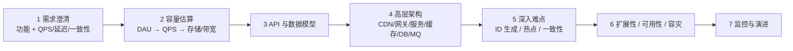

示例估算：DAU 1000 万、读写比 100:1 → 写约 11 QPS、读峰值约 3500 QPS、5 年存储约 0.9 TB → 结论：**读多写少，缓存是核心，单主 DB 足够**。

### 短链架构

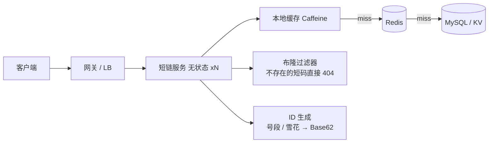

### 两个实测结论

1. **Zipf 流量下小缓存就有高命中率**：10 万 key，缓存 10% 的 key，Zipf 流量命中 73%、均匀流量只有 10%。先看访问分布再决定要不要缓存。
2. **并行 fan-out**：三个 60/90/70ms 的调用，串行 220ms，并行 92ms（= 最慢者）；非核心数据配 `completeOnTimeout` 降级。

### 利特尔法则

\[ L = \lambda \times W \]

3000 QPS × 50ms = 150 个并发请求 → 按每实例 200 线程、60% 利用率需 2 个实例。反过来：把延迟从 50ms 优化到 10ms，同样 QPS 只需 1/5 的并发——**优化延迟就是扩容**。

### 性能优化方法论

1. **先测量**：Arthas / async-profiler 火焰图 / JFR / APM，找真正的热点。
2. **由外向内**：架构（少调用）> 算法与数据结构 > IO（批量、缓存、异步）> JVM（GC、堆）> 代码微观。
3. 设定目标（P99 < 200ms），每次只改一个变量，压测验证。
4. 低垂果实：N+1 查询、缺索引、同步调外部接口、日志过多、锁粒度过大、线程池参数不当、序列化低效。

参考：[donnemartin/system-design-primer](https://github.com/donnemartin/system-design-primer)、《数据密集型应用系统设计》、ByteByteGo 系统设计系列。
